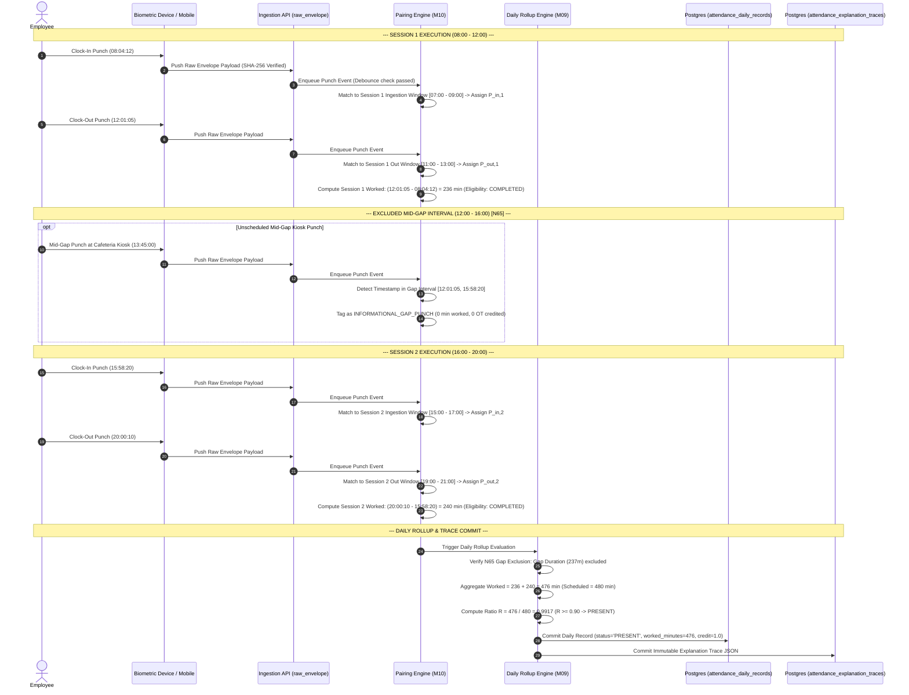
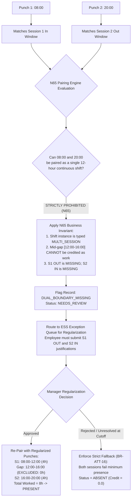

# APMS N65 Multi-Session Split Shift Timing & Gap Exclusion Specification

> **Status:** Authoritative | **Last Updated:** 2026-11-16 | **Source:** Extracted from APMS documentation (`attendance/SPEC.md` §3–§5, `BUSINESS_RULES.md` §2–§3, `BR-ATT-02`, `N65`, `N66a`, `N66b`, `Q4`)

---

## 1. Executive Overview & The N65 Non-Negotiable Invariant

In multi-session split shifts (widely utilized in hospitality, split healthcare rosters, educational institutions, and transport operations), an employee's scheduled work is partitioned into two or more distinct working sessions separated by an extended non-working interval (e.g., Session 1: 08:00–12:00, Mid-Gap: 12:00–16:00, Session 2: 16:00–20:00).

### The N65 Architectural Invariant (`BR-ATT-02`)
1. **Zero Worked Duration**: The interval between scheduled sessions $\text{Gap}_j = [T_{end, j}, T_{start, j+1}]$ is **strictly non-working time**. Under no circumstance may any duration within this gap be credited toward worked hours or daily wage calculations.
2. **Zero Overtime Denominator**: Gap time can never generate overtime hours. Staying on company premises during the gap does not accrue payable time without explicit, pre-authorized supervisor override.
3. **Mandatory Boundary Punches**: Boundary punches—Session $j$ Clock-Out and Session $j+1$ Clock-In—are mandatory. 
4. **Unrestricted Employee Movement**: Employees possess complete freedom of exit during the gap. Biometric signals registered on internal kiosks during the gap are tagged as informational and discarded from pairing.
5. **No Synthetic Merging**: Gap evaluation rules can never merge distinct sessions into a single continuous shift.

---

## 2. Chronological Timeline & Ingestion Windows

The diagram below illustrates the exact chronological architecture of a standard 2-session split shift (08:00–12:00 and 16:00–20:00), detailing the scheduled boundaries, ingestion tolerance windows, and the strictly excluded mid-gap.

```
Time:     07:00    08:00    08:15        12:00    13:00        15:00    16:00    16:15        20:00    21:00
Scale:    ──|────────|────────|────────────|────────|────────────|────────|────────|────────────|────────|────>
Events:     │        │        │            │        │            │        │        │            │        │
            │◄───────┼───────►│            │        │            │        │        │            │        │
            │  W_pre │ Grace  │            │  W_post│            │  W_pre │ Grace  │            │  W_post│
            │  (60m) │ (15m)  │            │ (120m) │            │  (60m) │ (15m)  │            │ (120m) │
            │        │        │            │        │            │        │        │            │        │
            ▼        ▼        ▼            ▼        ▼            ▼        ▼        ▼            ▼        ▼
       [Session 1 Ingestion Window]    [Session 1 Out]        [Session 2 Ingestion Window]    [Session 2 Out]
       [      07:00 - 09:00       ]    [11:00 - 13:00]        [      15:00 - 17:00       ]    [19:00 - 21:00]

       ├───────────────────────────────────┤                 ├───────────────────────────────────┤
       │             SESSION 1             │                 │             SESSION 2             │
       │    Scheduled: 08:00 - 12:00       │                 │    Scheduled: 16:00 - 20:00       │
       │       Target: 240 Minutes         │                 │       Target: 240 Minutes         │
       │     Min Presence (mu): 120m       │                 │     Min Presence (mu): 120m       │
       └───────────────────────────────────┘                 └───────────────────────────────────┘
                                           ▲                 ▲
                                           │                 │
                                           ├─────────────────┤
                                           │ EXCLUDED GAP    │
                                           │ 12:00 - 16:00   │
                                           │ Duration: 240m  │
                                           │ Worked Hours: 0 │
                                           │ Overtime: 0     │
                                           │ (N65 INVARIANT) │
                                           └─────────────────┘
```

---

## 3. End-to-End Multi-Session Punch Pairing Sequence

The following sequence diagram details the interaction between biometric terminals, raw ingestion, chronological pairing, gap filtering, and daily rollup trace persistence.



---

## 4. Missing Boundary Punch Scenarios & Penalty Governance

Because N65 requires distinct session boundaries, missing an IN or OUT punch disrupts pairing. The matrix below defines the deterministic system response for every permutation of missing boundary punches.

| Scenario | Punches Present | Punches Missing | Anomaly Flag | Session Eligibility | Daily Rollup Status | Mathematical Penalty |
| :--- | :--- | :--- | :--- | :--- | :--- | :--- |
| **Ideal Complete** | S1 IN, S1 OUT, S2 IN, S2 OUT | None | None | S1: `COMPLETED`<br>S2: `COMPLETED` | `PRESENT` | 0 penalty. Credit = 1.0. |
| **Missing S1 OUT** | S1 IN (08:02), S2 IN (15:55), S2 OUT (20:01) | S1 OUT (12:00) | `LONE_PUNCH_ANOMALY` (S1) | S1: `BELOW_MIN`<br>S2: `COMPLETED` | `HALF_DAY` (Capped) | S1 worked minutes = 0. Daily status capped at `HALF_DAY` under `BR-ROL-03` Split Deficit Rule. Credit = 0.5. |
| **Missing S2 IN** | S1 IN (08:00), S1 OUT (12:02), S2 OUT (20:05) | S2 IN (16:00) | `LONE_PUNCH_ANOMALY` (S2) | S1: `COMPLETED`<br>S2: `BELOW_MIN` | `HALF_DAY` (Capped) | S2 worked minutes = 0. Daily status capped at `HALF_DAY` under `BR-ROL-03` Split Deficit Rule. Credit = 0.5. |
| **Cross-Gap Unbroken Stay** | S1 IN (08:00), S2 OUT (20:00) | S1 OUT (12:00), S2 IN (16:00) | `MISSING_BOUNDARY_PUNCH`<br>`GAP_OVERSTAY_ANOMALY` | S1: `BELOW_MIN`<br>S2: `BELOW_MIN` | `NEEDS_REVIEW` $\rightarrow$ `ABSENT` (Default fallback) | S1 has no OUT, S2 has no IN. Invariant N65 strictly forbids spanning across the gap. If unregularized, both sessions fail: Credit = 0.0. |
| **Complete Absence in S2** | S1 IN (08:01), S1 OUT (12:00) | S2 IN, S2 OUT | `UNPAIRED_SESSION` (S2) | S1: `COMPLETED`<br>S2: `ABSENT` | `HALF_DAY` | Worked = 239m, Scheduled = 480m. Ratio $R = 0.4979 \approx 0.50$. Capped at `HALF_DAY`. Credit = 0.5. |
| **Single Lone Punch Entire Day** | S1 IN (08:05) only | S1 OUT, S2 IN, S2 OUT | `LONE_PUNCH_ANOMALY` (Q4) | S1: `BELOW_MIN`<br>S2: `ABSENT` | `NEEDS_REVIEW` $\rightarrow$ `ABSENT` | `BR-ATT-16`: Lone punch can never earn worked credit or overtime. If unregularized at cut-off: `ABSENT` (Credit = 0.0). |

---

## 5. Detailed Edge Case Handling

### 5.1 Edge Case: The "Continuous Stay" Trap
An employee clocks in at 08:00 for Session 1, remains on premises during the 12:00–16:00 mid-gap doing personal study or resting, and clocks out at 20:00 after Session 2 without punching at 12:00 or 16:00.



### 5.2 Edge Case: Session-Targeted Half-Day Leave (`N66c`)
An employee requests a half-day leave targeting Session 1 (`FIRST_HALF`):
1. **Target Session (Session 1)**: The minimum presence and scheduled hours requirements are waived. `leave_transactions` records a 0.5-day debit against Casual Leave / Paid Leave.
2. **Mid-Gap (12:00–16:00)**: Remains completely excluded (`N65`).
3. **Non-Target Session (Session 2)**: Employee clocks in at 15:58 and clocks out at 20:01:
   - Session 2 Worked Minutes = 240m.
   - Eligibility = `COMPLETED`.
4. **Daily Rollup Calculation**:
   $$\text{Daily Attendance Credit} = \text{Leave Credit } (0.50) + \text{Worked Session Credit } (0.50) = 1.00$$
   $$\text{Final Status} = \text{PRESENT (LEAVE\_ADJUSTED)}$$

### 5.3 Edge Case: Overtime Boundary Capping
An employee finishes Session 1 at 12:00, but clocks out at 13:00 (1 hour after scheduled session end):
- Ingestion window for Session 1 Out is $[11:00, 14:00]$. The punch at 13:00 is successfully paired as $P_{out, 1}$.
- **Overtime Evaluation (`BR-OTC-01` / `N20`)**:
  - The extra 60 minutes fall into the scheduled gap.
  - Does this count as payable overtime? **NO**, unless an explicit `OvertimeRequest` was pre-approved by the supervisor.
  - If unapproved, the engine caps Session 1 worked duration at $\text{ScheduledDuration}_1 + \text{GraceArrival} = 240\text{ minutes}$.
  - The extra 60 minutes are tagged `UNAUTHORIZED_EXTRA_TIME` and recorded in the Explanation Trace without contributing to daily worked hours.

---

## 6. Concrete Mathematical Verification Scenarios

### Test Scenario A: Clean Split Shift
- **Shift Schedule**: Session 1 [08:00–12:00], Gap [12:00–16:00], Session 2 [16:00–20:00].
- **Actual Punches**: 08:04:12, 12:01:05, 15:58:20, 20:00:10.
- **Calculations**:
  - $\text{Session 1 Worked} = 12:01:05 - 08:04:12 = 236\text{ min } 53\text{ sec} \rightarrow 236\text{ min}$.
  - $\text{Session 1 Eligibility}: 236 \ge 120 \rightarrow \mathbf{COMPLETED}$.
  - $\text{Gap Duration} = 15:58:20 - 12:01:05 = 237\text{ min } 15\text{ sec} \rightarrow \mathbf{0\text{ min credited}}$.
  - $\text{Session 2 Worked} = 20:00:10 - 15:58:20 = 241\text{ min } 50\text{ sec} \rightarrow 240\text{ min (capped at scheduled)}$.
  - $\text{Session 2 Eligibility}: 240 \ge 120 \rightarrow \mathbf{COMPLETED}$.
  - $\text{Total Worked} = 236 + 240 = 476\text{ min}$.
  - $\text{Coverage Ratio } R = \frac{476}{480} = 0.9917 \ge 0.90$.
- **Result**: **`PRESENT`**, Credit = 1.00, Late = 0 min, Early Exit = 0 min.

### Test Scenario B: Late Arrival in S1 + Split Deficit Penalty in S2
- **Shift Schedule**: Session 1 [08:00–12:00], Gap [12:00–16:00], Session 2 [16:00–20:00].
- **Actual Punches**: 08:45:00, 12:00:00, 17:30:00, 18:30:00.
- **Calculations**:
  - $\text{Session 1 Worked} = 12:00:00 - 08:45:00 = 195\text{ min}$.
  - $\text{Session 1 Late} = 08:45:00 - (08:00:00 + 15\text{m}) = 30\text{ min}$.
  - $\text{Session 1 Eligibility}: 195 \ge 120 \rightarrow \mathbf{COMPLETED}$.
  - $\text{Gap} = \mathbf{0\text{ min credited}}$.
  - $\text{Session 2 Worked} = 18:30:00 - 17:30:00 = 60\text{ min}$.
  - $\text{Session 2 Eligibility}: 60 < 120 \rightarrow \mathbf{BELOW\_MIN}$.
  - $\text{Total Worked} = 195 + 60 = 255\text{ min}$.
  - $\text{Coverage Ratio } R = \frac{255}{480} = 0.5312$ (Mathematically in Half-Day band $0.50 \le R < 0.90$).
  - **Split Deficit Trigger**: Because Session 2 is `BELOW_MIN`, status is strictly capped at `HALF_DAY`.
- **Result**: **`HALF_DAY`**, Credit = 0.50, Late = 30 min, S2 Deficit Flagged.
