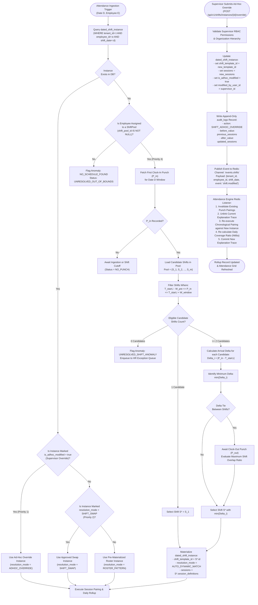
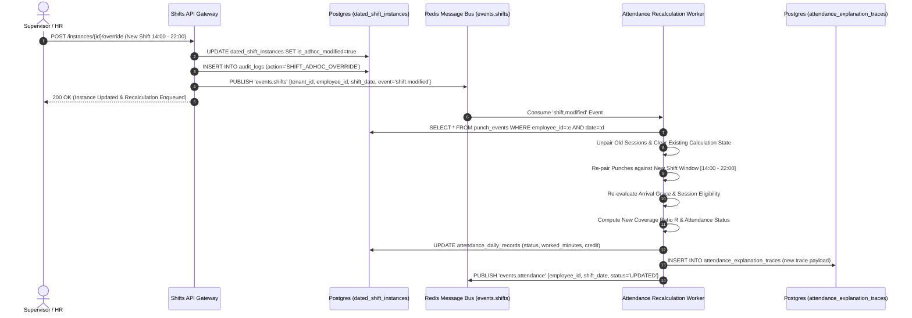

# APMS N67 Shift Matching & Schedule Override Engine Specification

> **Status:** Authoritative | **Last Updated:** 2026-11-16 | **Source:** Extracted from APMS documentation (`shifts/SPEC.md` §3–§4, `attendance/SPEC.md` §3, `BUSINESS_RULES.md` §3, `N67`, `SHF-06`, `ROS-03`, `BR-ROL-06`)

---

## 1. Executive Overview & Architectural Principles

The APMS Shifts & Rostering Engine manages the full operational lifecycle of work schedules. A fundamental requirement in complex operational environments (manufacturing plants, hospitals, multi-shift customer support centers) is the dynamic and deterministic resolution of an employee's shift for a target calendar date $D$.

APMS implements a **multi-tiered shift resolution architecture** governed by the confirmed **N67 dual-path schedule modification framework**:
1. **Pre-Materialization (`ROS-03` / `ADR-15`)**: Recurring roster patterns are pre-materialized up to 30 days in advance as concrete, immutable `dated_shift_instance` rows.
2. **Dynamic Pool Auto-Detection (`SHF-06`)**: For unscheduled or pooled workers, punches are automatically mapped to the closest candidate shift based on arrival timestamp deltas.
3. **Ad-Hoc Same-Day Overrides (`N67` / `BR-ROL-06`)**: Managers can directly override an employee's schedule on the fly without corrupting the master rotation template.
4. **Reactive Recalculation Pipeline**: Any shift modification dynamically publishes a message to the Redis event bus, immediately tearing down existing punch pairings and triggering a clean recalculation.

---

## 2. Shift Resolution Hierarchy & Precedence Matrix

When evaluating attendance for date $D$, the system resolves the governing shift instance using a strict priority waterfall:

```
[Priority 1: Ad-Hoc Supervisor Override (N67 / BR-ROL-06)]
       │ (Explicit supervisor modification on dated_shift_instance)
       ▼ [If not present]
[Priority 2: Approved Employee Shift Swap / Change Request]
       │ (Approved ESS request with peer or supervisor consent)
       ▼ [If not present]
[Priority 3: Pre-Materialized Roster Pattern (ROS-03)]
       │ (Materialized from recurring weekly/cyclical roster template)
       ▼ [If not present]
[Priority 4: Dynamic Shift Pool Auto-Matching (SHF-06)]
       │ (Real-time arrival delta minimization across candidate pool)
       ▼ [If matching fails]
[Priority 5: Exception Queue: UNRESOLVED_SHIFT_ANOMALY]
         (Enqueued in Human Exception Queue for manual assignment)
```

| Priority Level | Resolution Mode | Trigger / Source | Mutates Master Template? | Re-Calculation Behavior | Audit Trail Requirement |
| :--- | :--- | :--- | :--- | :--- | :--- |
| **1 (Highest)** | `ADHOC_OVERRIDE` | Supervisor UI / API direct override | No (modifies `dated_shift_instance` only) | Synchronous Redis event `shift.modified`; immediate un-pair & re-rollup | Mandatory reason code + supervisor user ID in `audit_logs` |
| **2** | `SHIFT_SWAP` | Approved ESS swap workflow | No (swaps instance templates between 2 employees) | Dual-event `shift.swapped`; re-evaluates both employees | Approval audit trace + swap consent timestamps |
| **3** | `ROSTER_PATTERN` | Automated 30-day cron materialization | N/A (instantiates master pattern) | Standard nightly batch rollup | Background worker execution log |
| **4** | `AUTO_DYNAMIC_MATCH` | First physical punch $P_{in}$ within pool window | No (selects candidate template from assigned pool) | On-demand creation of `dated_shift_instance` upon punch arrival | Algorithmic delta calculation logged in Explanation Trace |
| **5 (Fallback)**| `MANUAL_EXCEPTION` | HR manual intervention after failed match | No (creates ad-hoc instance) | Manual re-trigger command | User ID + reason code |

---

## 3. Complete Dual-Path Shift Matching & Override Algorithm

The following flowchart details the end-to-end resolution algorithm across scheduled patterns, dynamic pool auto-detection, and supervisor overrides.



---

## 4. Dynamic Shift Pool Matching Engine (`SHF-06`)

### 4.1 Mathematical Formulation
Consider an employee assigned to dynamic shift pool $\mathcal{P} = \{ S_1, S_2, \dots, S_m \}$, where each candidate shift $S_i$ specifies:
- Scheduled Start Time: $T_{start, i}$
- Scheduled End Time: $T_{end, i}$
- Ingestion Early Window: $W_{pre, i}$ (Default: 60 minutes)
- Ingestion Late Window: $W_{window, i}$ (Default: 120 minutes)

When the initial punch $P_{in}$ arrives:

#### Step 1: Window Qualification
Candidate set $\mathcal{C} \subseteq \mathcal{P}$ is defined by:
$$\mathcal{C} = \left\{ S_i \in \mathcal{P} \;\middle|\; (T_{start, i} - W_{pre, i}) \le P_{in} \le (T_{start, i} + W_{window, i}) \right\}$$

#### Step 2: Arrival Delta Minimization
For each candidate $S_i \in \mathcal{C}$, compute the arrival delta $\Delta_i$:
$$\Delta_i = \left| P_{in} - T_{start, i} \right|$$

The primary matched shift $S^*$ satisfies:
$$S^* = \arg\min_{S_i \in \mathcal{C}} \Delta_i$$

#### Step 3: Tie-Breaking Overlap Ratio
If multiple shifts yield an identical delta ($\Delta_a = \Delta_b$), resolution waits for $P_{out}$. The shift maximizing the duration overlap ratio $\Omega_i$ is selected:
$$\Omega_i = \frac{\min(P_{out}, T_{end, i}) - \max(P_{in}, T_{start, i})}{T_{end, i} - T_{start, i}}$$

### 4.2 Dynamic Pool Example Matrix
A 24/7 manufacturing facility configures Pool `MFG-3-ROTATION`:
- **Shift 1 (Morning)**: 06:00–14:00 ($W_{pre}=60\text{m}, W_{window}=120\text{m} \rightarrow [05:00, 08:00]$)
- **Shift 2 (Afternoon)**: 14:00–22:00 ($W_{pre}=60\text{m}, W_{window}=120\text{m} \rightarrow [13:00, 16:00]$)
- **Shift 3 (Night)**: 22:00–06:00 ($W_{pre}=60\text{m}, W_{window}=120\text{m} \rightarrow [21:00, 00:00]$)

| Actual Punch $P_{in}$ | Qualified Candidates $\mathcal{C}$ | Deltas $\Delta_i$ | Matched Shift $S^*$ | Resolution Action |
| :--- | :--- | :--- | :--- | :--- |
| **05:48:10** | $\{ S_1 \}$ | $\Delta_1 = \|05:48:10 - 06:00:00\| = 11\text{m } 50\text{s}$ | **Shift 1 (06:00–14:00)** | Auto-materialize $S_1$; Late = 0m |
| **06:14:00** | $\{ S_1 \}$ | $\Delta_1 = \|06:14:00 - 06:00:00\| = 14\text{m } 00\text{s}$ | **Shift 1 (06:00–14:00)** | Auto-materialize $S_1$; Within 15m Grace |
| **13:45:20** | $\{ S_2 \}$ | $\Delta_2 = \|13:45:20 - 14:00:00\| = 14\text{m } 40\text{s}$ | **Shift 2 (14:00–22:00)** | Auto-materialize $S_2$; Late = 0m |
| **21:50:00** | $\{ S_3 \}$ | $\Delta_3 = \|21:50:00 - 22:00:00\| = 10\text{m } 00\text{s}$ | **Shift 3 (22:00–06:00)** | Auto-materialize $S_3$; Overnight shift attribution to current date |
| **10:15:00** | $\emptyset$ (No matching window) | N/A | **None** | Flag `UNRESOLVED_SHIFT_ANOMALY`; enqueue in Human Exception Queue |

---

## 5. Ad-Hoc Same-Day Schedule Override Engine (`N67`, `BR-ROL-06`)

### 5.1 Dual-Path Modification Triggers
1. **Path 1: Supervisor Direct Override**
   - **Endpoint**: `POST /api/v1/shifts/instances/{id}/override`
   - **Authorization**: `ROLE_SHIFT_SUPERVISOR`, `ROLE_DEPT_MANAGER`, or `ROLE_HR_ADMIN`.
   - **Payload**:
     ```json
     {
       "shift_template_id": "018f3a5b-9a8c-7000-8b01-444444444444",
       "reason_code": "MACHINE_BREAKDOWN_REALLOCATION",
       "custom_sessions": null,
       "notify_employee": true
     }
     ```
2. **Path 2: Employee Shift Swap Request via ESS**
   - **Endpoint**: `POST /api/v1/shifts/requests/adhoc-change`
   - **Workflow**: Submits a swap request targeting a colleague for date $D$. Once the colleague accepts and the supervisor approves in `M9`, the system automatically executes the instance mutation.

### 5.2 Database State Transition & Immutability Rules
- Master templates in `shift_templates` and recurring rules in `roster_patterns` are **never modified**.
- The specific `dated_shift_instances` row is updated:
  - `is_adhoc_modified = true`
  - `resolution_mode = 'ADHOC_OVERRIDE'`
  - `modified_by_user_id = :supervisor_uuid`
  - `modification_reason = :reason_string`
  - `updated_at = clock_timestamp()`
- An append-only audit entry is committed to `audit_logs` capturing before and after JSON snapshots.

---

## 6. Real-Time Invalidation & Recalculation Flow

When an ad-hoc override or swap is approved, the system guarantees zero data staleness through an event-driven Redis pub/sub pipeline:



---

## 7. Audit Log JSON Payload Structure

Every execution of an ad-hoc override stores an immutable record in `audit_logs`:

```json
{
  "id": "018f3a5b-9a8c-7000-8b01-999999999999",
  "tenant_id": "018f3a5b-9a8c-7000-8b01-111111111111",
  "user_id": "018f3a5b-9a8c-7000-8b01-777777777777",
  "action": "SHIFT_ADHOC_OVERRIDE",
  "entity_type": "dated_shift_instances",
  "entity_id": "018f3a5b-9a8c-7000-8b01-333333333333",
  "ip_address": "192.168.1.104",
  "before_value": {
    "shift_template_id": "018f3a5b-9a8c-7000-8b01-444444444444",
    "shift_name": "General Morning Shift (08:00 - 16:30)",
    "resolution_mode": "ROSTER_PATTERN",
    "is_adhoc_modified": false
  },
  "after_value": {
    "shift_template_id": "018f3a5b-9a8c-7000-8b01-555555555555",
    "shift_name": "Evening Split Shift (14:00 - 22:00)",
    "resolution_mode": "ADHOC_OVERRIDE",
    "is_adhoc_modified": true,
    "modification_reason": "Emergency cover for boiler operator absence",
    "modified_by_user_id": "018f3a5b-9a8c-7000-8b01-777777777777"
  },
  "created_at": "2026-11-16T11:42:15.820Z"
}
```
