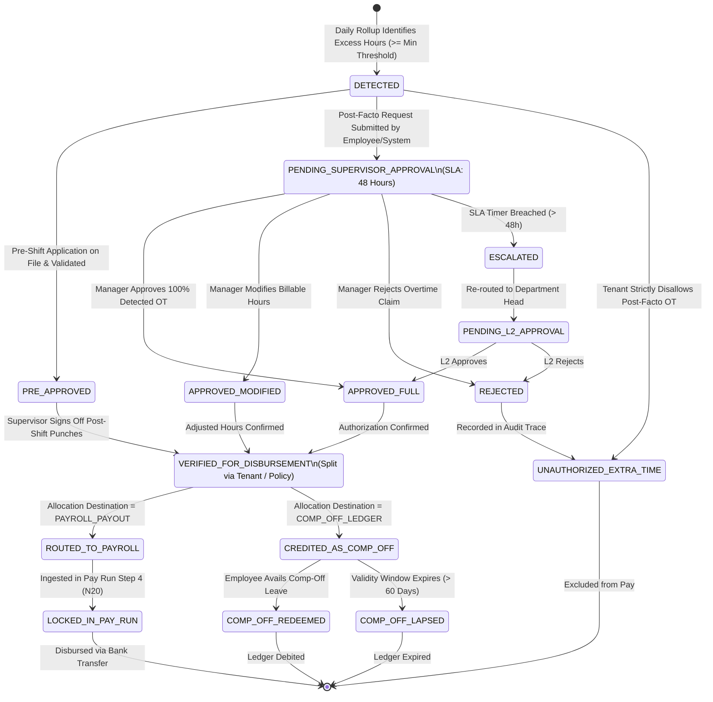

# APMS Overtime Multi-Tier Calculation & Allocation Workflow Specification

> **Status:** Authoritative | **Last Updated:** 2026-11-16 | **Source:** Extracted from APMS documentation (`attendance/SPEC.md` §3–§7, `payroll/SPEC.md` §2–§4, `leave/SPEC.md` §2–§4, `BUSINESS_RULES.md` `BR-OTC-01`, `BR-ATT-02`, `BR-ATT-16`, Factories Act 1948 §51, §54, §59)

---

## 1. Executive Overview & Architectural Invariants

The APMS Overtime Engine manages the end-to-end lifecycle of extra worked hours—from biometric detection and threshold evaluation to statutory weekly accumulation, multi-tier authorization, and dual destination allocation (payroll monetary payout vs. double-entry Compensatory Off credit).

### Non-Negotiable Invariants
1. **Explicit Authorization Mandate (`BR-OTC-01` / `N20`)**: Worked duration exceeding scheduled shift hours does **NOT** automatically convert to payable overtime. All overtime hours require explicit supervisor/manager authorization prior to payroll credit. Extra hours lacking approval are logged as `UNAUTHORIZED_EXTRA_TIME` and strictly excluded from financial payouts.
2. **Multi-Session Gap Exclusion (`BR-ATT-02` / `N65`)**: In split shifts, non-working intervals between scheduled sessions are strictly excluded from worked hours, late marks, and overtime denominators.
3. **Statutory Non-Negotiables (Factories Act 1948 §51, §54, §59)**:
   - **Daily Limit**: Normal working hours capped at 9 hours/day. Hours beyond 9 qualify as daily overtime.
   - **Weekly Limit**: Normal working hours capped at 48 hours/week. Total cumulative hours beyond 48 hours qualify as statutory weekly overtime.
   - **Statutory Multiplier**: Overtime wages are legally mandated at **twice the ordinary rate of wages ($2.0\times$)** under Section 59 for factory workers, and $1.5\times$ to $2.0\times$ under state-specific Shops and Commercial Establishments Acts.
   - **Absolute Maximum Working Limits**: No worker can be made to work more than 10 hours in any day or 60 hours in any week, with a statutory maximum quarterly overtime cap (50 to 75 hours depending on state amendments).
4. **Double-Entry Comp-Off Ledger (`BR-LVE-01`)**: When overtime is compensated via time-off (Comp-Off) rather than payroll encashment, credits are recorded as append-only `leave_transactions` rows (`transaction_type: 'ACCRUAL'`, `leave_type: 'COMP_OFF'`) bound to an immutable validity expiration window (default 60 days).
5. **Lone-Punch Rejection (`BR-ATT-16`)**: Under no circumstances can a lone punch generate overtime hours or unearned attendance credit.
6. **Deterministic Explanation Traceability (`SPEC §7`)**: Every overtime calculation step—including gross minutes, threshold grace deductions, rate multipliers, and approval metadata—must produce an immutable JSON explanation trace stored in the daily attendance rollup and ingested into payroll pay run snapshots.

---

## 2. End-to-End Overtime Calculation & Allocation Flowchart

The following Mermaid flowchart models the complete lifecycle of overtime: from raw punch pair aggregation, threshold checking, and statutory accumulation, through approval routing, to payroll encashment or comp-off allocation.

```mermaid
flowchart TD
    Start(["Daily Punch Pairing Finalized (Date D, Employee E)"]) --> CalcWorked["1. Calculate Total Validated Worked Minutes\n(Subtract N65 Inter-Session Gaps)"]
    
    %% Step 1: Threshold & Grace Verification
    CalcWorked --> FetchPolicy["Fetch Shift Policy & OT Parameters\n(Daily Threshold, Grace Period, Min OT Threshold)"]
    FetchPolicy --> CheckDailyOT{"Worked Minutes >\nScheduled Shift Minutes\n+ Daily Grace Period?"}

    CheckDailyOT -- "No" --> ZeroDailyOT["Daily OT = 0.0 Hours\nRegular Attendance Normal Rollup"]
    CheckDailyOT -- "Yes" --> CalcExcess["Calculate Raw Excess Minutes:\nExcess = Worked - Scheduled Shift"]
    
    CalcExcess --> CheckMinBlock{"Excess Minutes >=\nMin OT Threshold?\n(e.g. >= 30 mins)"}
    CheckMinBlock -- "No" --> TagIncidental["Flag as INCIDENTAL_STAY\nDaily OT = 0.0 Hours (No Pay)"]
    CheckMinBlock -- "Yes" --> RoundingBlock["Apply OT Rounding Rule\n(15-min / 30-min block floor)"]
    
    RoundingBlock --> CheckPreApproved{"Was Pre-Approved OT\nRegistered for Date D?\n(Pre-Shift Overtime Form)"}
    
    %% Step 2: Approval Routing
    CheckPreApproved -- "Yes" --> MatchPreApproved["Match with Pre-Approved Cap:\nDaily OT = min(Raw OT, Pre-Approved Cap)"]
    MatchPreApproved --> StatusPreApproved["Set Status: PRE_APPROVED_PENDING_VERIFY"]
    
    CheckPreApproved -- "No" --> CheckTenantPolicy{"Tenant Requires\nPre-Approval Only?"}
    CheckTenantPolicy -- "Yes (Strict)" --> DisallowPostFacto["Mark: UNAUTHORIZED_EXTRA_TIME\nDaily OT = 0.0 Hours (Excluded from Pay)"]
    CheckTenantPolicy -- "No (Post-Facto Allowed)" --> QueuePostFacto["Submit Post-Facto OT Request\nWorkflow: M18 Approval Engine"]
    
    QueuePostFacto --> SupervisorDecision{"Supervisor / Manager\nDecision (BR-OTC-01)?"}
    SupervisorDecision -- "Rejected" --> LogRejected["Mark: UNAUTHORIZED_EXTRA_TIME\nPersist Audit Reason in Trace"]
    SupervisorDecision -- "Modified Hours" --> SetAdjustedOT["Set Daily OT = Approved Lower Hours"]
    SupervisorDecision -- "Approved Full" --> SetApprovedOT["Set Daily OT = Calculated OT Hours"]
    
    StatusPreApproved --> VerifyManager["Supervisor Post-Shift Sign-Off"]
    VerifyManager --> SetApprovedOT

    %% Step 3: Weekly Cap & Statutory Accumulation
    SetApprovedOT --> AccumWeekly["2. Weekly Overtime Engine Accumulator\nAggregate Mon-Sun Worked Hours in Pay Group"]
    SetAdjustedOT --> AccumWeekly
    
    AccumWeekly --> CheckWeeklyCap{"Total Cumulative\nWeekly Hours > 48h?\n(Factories Act §51)"}
    CheckWeeklyCap -- "Yes" --> ApplyStatutoryOT["Add Difference to Weekly Statutory OT Accumulator\nStatutory Rate Band Triggered"]
    CheckWeeklyCap -- "No" --> DailyOTOnly["Record as Standard Daily Overtime"]
    
    ApplyStatutoryOT --> CheckAbsoluteMax{"Total Weekly Hours > 60h\nOR Quarterly OT > Limit?\n(Factories Act §54/64)"}
    CheckAbsoluteMax -- "Yes" --> FlagStatutoryBreach["Flag STATUTORY_OT_BREACH_WARNING\nNotify HR & Factory Compliance Officer"]
    CheckAbsoluteMax -- "No" --> RouteDestination
    FlagStatutoryBreach --> RouteDestination

    %% Step 4: Destination Choice: Encashment vs Comp-Off
    DailyOTOnly --> RouteDestination{"3. Determine Allocation Destination\n(Employee Preference / Tenant Policy)"}
    
    RouteDestination -- "Option A: Encashment via Payroll" --> PayrollPath["Route to Payroll Engine (M12)\nPending Pay Run Ingestion (Step 4)"]
    PayrollPath --> FetchPayGroupRate["Fetch Pay Group Overtime Multiplier:\n- Standard Days: 1.5x / 2.0x\n- Rest Day / Holiday: 2.0x (Double Rate)"]
    FetchPayGroupRate --> CalcOTPay["Calculate OT Monetary Amount:\nOT_Amount = OT_Hours * Hourly_Wage * Multiplier"]
    CalcOTPay --> IngestPayRun["Ingest into Pay Run Step 4 (N20 Authorized)\nWrite to pay_run_employee_snapshots"]

    RouteDestination -- "Option B: Compensatory Off (Comp-Off)" --> CompOffPath["Route to Leave Engine (M11)\nDouble-Entry Ledger Ingestion"]
    CompOffPath --> ConvertToLeaveCredits["Convert OT Hours to Comp-Off Days:\n(e.g., 8 Hours OT = 1.0 Comp-Off Day,\n4 Hours OT = 0.5 Comp-Off Day)"]
    ConvertToLeaveCredits --> InsertLeaveTx["Insert Immutable Row in leave_transactions:\ntransaction_type = ACCRUAL\nleave_type = COMP_OFF\nvalid_until = Date_D + 60 Days"]
    InsertLeaveTx --> ArmExpiryScheduler["Arm Celery Expiry Task at T+60 Days\nAuto-lapse unused balance if unredeemed"]

    %% Step 5: Explanation Trace & Finalization
    IngestPayRun --> GenTrace["4. Generate Deterministic Explanation Trace JSON"]
    ArmExpiryScheduler --> GenTrace
    DisallowPostFacto --> GenTrace
    LogRejected --> GenTrace
    ZeroDailyOT --> EndRollup(["Rollup Persisted in daily_attendance_rollup"])
    GenTrace --> EndRollup
```



---

## 3. Mathematical Formulation & Statutory Rate Multipliers

### 3.1 Daily Overtime Formulation
Let $T_{\text{worked}}$ be the validated worked minutes for calendar date $D$ (strictly excluding inter-session gaps $T_{\text{gap}}$ as mandated by `BR-ATT-02`). Let $T_{\text{scheduled}}$ be the scheduled shift duration in minutes, $T_{\text{grace}}$ be the tenant policy daily grace period (typically 15 minutes), and $T_{\text{min\_ot}}$ be the minimum excess duration required to trigger overtime (typically 30 minutes).

$$\text{Raw Excess Minutes} = \max(0, T_{\text{worked}} - T_{\text{scheduled}} - T_{\text{grace}})$$

$$\text{Daily OT Minutes} = 
\begin{cases} 
\text{RoundFloor}(\text{Raw Excess Minutes}, \Delta_{\text{block}}), & \text{if } \text{Raw Excess Minutes} \ge T_{\text{min\_ot}} \\
0, & \text{otherwise (Incidental Stay)}
\end{cases}$$

Where $\Delta_{\text{block}}$ is the configured quantization increment (e.g., 15 minutes = 0.25 hours, 30 minutes = 0.50 hours).

### 3.2 Weekly Overtime Accumulation (Factories Act 1948 §51)
In accordance with Indian statutory requirements, weekly overtime must be reconciled across the designated 7-day work week (Monday 00:00 to Sunday 23:59):

$$H_{\text{weekly\_worked}} = \sum_{i=1}^{7} H_{\text{worked}, i}$$

$$H_{\text{weekly\_ot}} = \max(0, H_{\text{weekly\_worked}} - 48.0)$$

Where $H_{\text{weekly\_worked}}$ is the sum of total daily worked hours. If daily overtime has already been compensated on individual days, the weekly engine reconciles the greater of the cumulative daily OT and the weekly 48-hour threshold excess to avoid double-penalizing or under-compensating:

$$H_{\text{statutory\_ot\_payable}} = \max\left(\sum_{i=1}^{7} H_{\text{daily\_ot}, i}, \ H_{\text{weekly\_ot}}\right)$$

### 3.3 Statutory Rate Multipliers

| Category / Day Type | Statutory Reference | Standard Rate Multiplier | Basis of Ordinary Rate |
| :--- | :--- | :--- | :--- |
| **Factory Worker (Standard Workday)** | Factories Act 1948 §59(1) | **$2.0\times$ (Double Ordinary Rate)** | Basic Wage + DA + Cash Equivalents of Food Concessions |
| **Commercial / IT / Retail Employee** | State Shops & Establishments Acts (e.g., MH, KA, DL) | **$1.5\times$ to $2.0\times$** | Fixed Monthly Gross / Standard Working Hours |
| **Weekly Off (Rest Day) Work** | Factories Act 1948 §52 / State Acts | **$2.0\times$ OR $1.0\times$ + Compensatory Off** | Full Day Rate + Alternate Off within 3 days before/after |
| **Declared National / Public Holiday** | National & Festival Holidays Act | **$2.0\times$ (Double Wages)** + Holiday Credit | Double wages for hours worked in addition to regular holiday pay |

### 3.4 Ordinary Hourly Wage Calculation
For salaried employees governed by monthly gross structures:

$$\text{Ordinary Hourly Wage} = \frac{\text{Monthly Qualifying Wage Basis}}{D_{\text{basis}} \times H_{\text{shift}}}$$

- **$\text{Monthly Qualifying Wage Basis}$**: Basic Salary + Dearness Allowance (DA) for Factories Act compliance; Total Fixed Gross (excluding discretionary bonuses) for Shops & Establishments.
- **$D_{\text{basis}}$**: Days in month divisor governed by tenant pay group policy (e.g., 26 days statutory standard, or actual calendar days 28/30/31).
- **$H_{\text{shift}}$**: Standard scheduled shift length (typically 8.0 hours).

---

## 4. Multi-Tier Approval States & Workflow Lifecycle

All overtime processing is decoupled from the core payroll engine via the APMS Workflow Engine (`M18`). An employee's extra hours transition through an auditable finite-state machine:



---

## 5. Destination A: Encashment via Payroll Engine (`M12`)

When overtime is designated for monetary compensation:
1. **Attendance Snapshot Handoff**: The finalized daily attendance rollup records `overtime_hours_approved` and `overtime_rate_multiplier`.
2. **Pay Cut-Off Ingestion (`Step 4 - N20`)**: During Step 4 of the Guided 10-Step Pay Run Wizard, the payroll engine executes a strict SQL query against the daily attendance summaries:
   ```sql
   SELECT 
       employee_id,
       SUM(overtime_hours_approved) AS total_approved_ot_hours,
       SUM(overtime_hours_approved * hourly_rate * overtime_rate_multiplier) AS total_ot_earnings
   FROM daily_attendance_rollup
   WHERE tenant_id = :current_tenant_id
     AND date BETWEEN :period_start AND :period_end
     AND overtime_status IN ('VERIFIED_FOR_DISBURSEMENT', 'LOCKED_IN_PAY_RUN')
     AND overtime_destination = 'PAYROLL_PAYOUT'
   GROUP BY employee_id;
   ```
3. **Period Lock Immutability (`BR-PAY-12`)**: Once Step 8 freezes the pay run into `LOCKED` state, all included overtime hours receive status `LOCKED_IN_PAY_RUN`. Any retroactive overtime approvals submitted after period cut-off are automatically deflected to the **Next-Cycle Arrears Engine** (`PAYROLL_ARREARS_ENGINE.md`).

---

## 6. Destination B: Compensatory Off (Comp-Off) Double-Entry Ledger (`M11`)

When overtime is converted into time-off entitlements:
1. **Conversion Ratio**: 
   - Standard Overtime: 8 approved OT hours = 1.0 Comp-Off Day (or 4 approved hours = 0.5 Comp-Off Day).
   - Holiday / Rest Day Work: 1 full day of worked holiday = 1.0 Comp-Off Day regardless of duration above 4 hours.
2. **Double-Entry Balance Credit**: The Leave Engine issues an atomic, append-only ledger transaction:
   ```sql
   INSERT INTO leave_transactions (
       id, tenant_id, employee_id, leave_type_id, 
       transaction_type, units, balance_after,
       effective_date, valid_until, reference_id, metadata
   ) VALUES (
       gen_random_uuid(), :tenant_id, :employee_id, :comp_off_leave_type_id,
       'ACCRUAL', :earned_days, :prior_balance + :earned_days,
       :work_date, :work_date + INTERVAL '60 days', :ot_approval_id,
       jsonb_build_object(
           'source', 'OVERTIME_CONVERSION',
           'approved_ot_hours', :ot_hours,
           'expiry_days', 60
       )
   );
   ```
3. **Automated Lapse Engine (`WFL-04`)**:
   - Comp-off balances cannot be carried forward indefinitely or banked beyond statutory limits.
   - A daily background Celery task scans for expired unredeemed transactions where `valid_until < CURRENT_DATE` and `remaining_units > 0`.
   - The engine automatically writes a debit row (`transaction_type: 'LAPSE'`), decrementing the balance to prevent unauthorized leave liability accumulation.

---

## 7. Deterministic Overtime Explanation Trace Schema

To ensure 100% financial auditability and satisfy labor inspectorate queries under Section 59 of the Factories Act, every daily attendance record calculating overtime persists an immutable JSON trace:

```json
{
  "trace_version": "1.0",
  "employee_id": "018f4a12-8871-7000-a111-000000000045",
  "date": "2026-11-16",
  "shift_code": "GEN-01",
  "shift_start": "09:00:00",
  "shift_end": "18:00:00",
  "scheduled_duration_minutes": 540,
  "break_duration_minutes": 60,
  "net_scheduled_work_minutes": 480,
  "punch_analysis": {
    "first_in": "2026-11-16T08:55:12+05:30",
    "last_out": "2026-11-16T21:05:40+05:30",
    "gross_clocked_minutes": 730,
    "inter_session_gap_minutes_deducted": 0,
    "net_worked_minutes": 730
  },
  "overtime_calculation": {
    "raw_excess_minutes": 250,
    "grace_period_minutes": 15,
    "net_eligible_excess_minutes": 235,
    "rounding_block_minutes": 15,
    "quantized_ot_minutes": 225,
    "quantized_ot_hours": 3.75,
    "minimum_threshold_passed": true
  },
  "weekly_reconciliation": {
    "prior_accumulated_weekly_hours": 42.0,
    "current_day_normal_hours": 8.0,
    "current_day_ot_hours": 3.75,
    "updated_weekly_hours": 53.75,
    "statutory_weekly_ot_excess_hours": 5.75,
    "statutory_limit_exceeded": false
  },
  "authorization_metadata": {
    "authorization_type": "POST_FACTO_APPROVAL",
    "workflow_id": "wf_ot_9928174a-281b-4029",
    "approver_id": "018f4a12-8871-7000-a000-000000000012",
    "approver_role": "REPORTING_MANAGER",
    "approved_ot_hours": 3.75,
    "approval_timestamp": "2026-11-17T10:14:22+05:30",
    "audit_remarks": "Critical production line maintenance approved"
  },
  "destination_allocation": {
    "destination": "PAYROLL_PAYOUT",
    "rate_multiplier": 2.0,
    "statutory_clause": "FACTORIES_ACT_1948_SEC_59",
    "base_hourly_rate": 187.50,
    "projected_overtime_payout_inr": 1406.25
  }
}
```

---

## 8. Anti-Gaming Guardrails & Edge Cases

1. **Lone-Punch Guardrail (`BR-ATT-16`)**: If an employee registers a single punch (e.g., In-Punch at 09:00 without an Out-Punch), the system immediately halts overtime calculation. Lone punches can **never** trigger overtime, regardless of how many hours have elapsed.
2. **Inter-Session Gap Invariant (`N65`)**: On split shifts (e.g., Session 1: 08:00–12:00, Session 2: 16:00–20:00), staying on premises during the 12:00–16:00 gap does not generate overtime. Only punches extending beyond 12:00 (Session 1) or 20:00 (Session 2) past the grace period qualify.
3. **Split WFH Phantom OT Block (`BR-ATT-17`)**: Telecommuting / WFH punches aggregate cumulative active minutes. The engine hard-caps total compensated minutes at the scheduled shift duration unless a manager has issued a pre-approved digital overtime token.
4. **Statutory Fatigue Alert Threshold**: If an employee accumulates $> 12.0$ total worked hours in a single calendar day or $> 60.0$ hours in a work week, the engine generates an automated high-priority compliance ticket to HR Operations and the EHS (Environment, Health & Safety) Officer for violation of the Factories Act maximum threshold.
