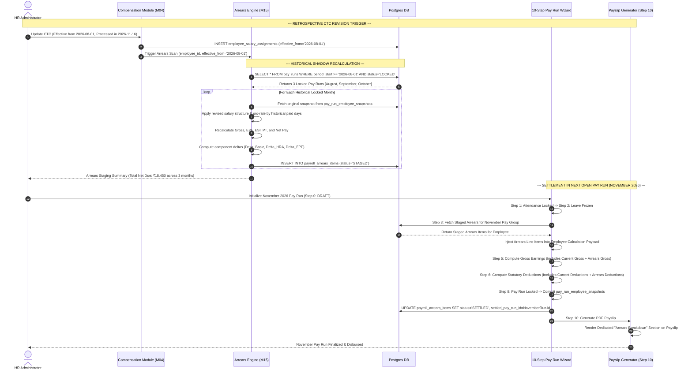

# APMS Retrospective Salary Revision & Payroll Arrears Settlement Engine

> **Status:** Authoritative | **Last Updated:** 2026-11-16 | **Source:** Extracted from APMS documentation (`payroll/SPEC.md` §3–§4, `attendance/SPEC.md` §3, `BUSINESS_RULES.md` §6, `ADR-07`, `ADR-09`, `ADR-25`, `BR-PAY-12`, `BR-STA-01`–`04`)

---

## 1. Executive Overview & Core Architectural Invariants

In enterprise workforce management, retrospective adjustments are frequent: an annual salary increment announced in November may take effect retroactively from April; an employee's dispute regarding a biometric hardware outage in September may be regularized in November; or a medical leave application may be submitted weeks after hospital discharge.

Traditional legacy systems often rewrite historical pay runs in place, corrupting financial ledgers, breaking statutory bank reconciliation, and violating audit compliance. APMS strictly prohibits historical mutation.

### Non-Negotiable Invariants
1. **Strict Period Lock & Next-Cycle Arrears Routing (`BR-PAY-12`)**: Once a pay run reaches `LOCKED` (Step 8 of the 10-Step Wizard), historical attendance summaries, leave transactions, and `pay_run_employee_snapshots` become **permanently immutable**.
2. **Historical Shadow Recalculation**: The arrears engine never touches historical rows. It executes an isolated "shadow recalculation" against historical parameters, evaluates the differential delta ($\Delta$), and enqueues the delta into the **next active open pay run**.
3. **Statutory Parameter Versioning (`ADR-25`)**: Retrospective calculations must apply the exact statutory limits (EPF ceilings, ESI thresholds, state PT slabs) that were legally effective during the historical target month, retrieved from `statutory_parameter_versions`.
4. **Transparent Payslip Traceability (`PSL-03`)**: Every arrears disbursement must be itemized on the current month's payslip showing the exact source month, revised component, and differential calculation breakdown.

---

## 2. Trigger Events Leading to Payroll Arrears

| Trigger Category | Operational Scenario | Affected Variables | Mathematical Impact |
| :--- | :--- | :--- | :--- |
| **Retrospective CTC Revision** | Annual appraisal finalized in November, with effective date backdated to April 1st (`effective_from = '2026-04-01'`). | Annual CTC, Basic, HRA, Special Allowance, PF Base. | Increases Gross Earnings and Statutory Deductions for April through October. |
| **Post-Lock Attendance Regularization** | Employee regularizes an un-paired lone punch or unexcused absence for a locked month (`ATT-10`). | Paid Days ($+1.0$), Loss of Pay Days ($-1.0$). | Refunds previously deducted Loss of Pay (LOP) wages. |
| **Backdated Leave Approval** | Medical leave with hospital certificate approved after monthly payroll freeze (`LVE-01`). | LOP Days converted to Paid Sick Leave days. | Reverses LOP deduction; adjusts double-entry leave ledger. |
| **Delayed Overtime Authorization** | Manager approves overtime hours after the 25th monthly payroll cut-off window (`N20`). | Approved OT Hours ($+H_{ot}$). | Credits payable overtime earnings into next cycle. |
| **Retrospective Recovery (Negative Arrears)** | HR audit discovers an unauthorized overpayment or unrecorded post-lock leave in a prior month. | LOP Days ($+1.0$). | Generates a negative delta (salary recovery) deducted from next cycle. |

---

## 3. End-to-End Arrears Engine Processing Flowchart

The following flowchart illustrates the entire arrears pipeline—from trigger event detection and historical shadow recalculation to differential ledger staging and next-cycle payroll injection.

```mermaid
flowchart TD
    Start(["Trigger Event Detected:\n- Retrospective CTC Revision\n- Post-Lock Attendance Regularization\n- Backdated Approved Leave\n- Post-Lock Overtime Approval"]) --> IdentifyPeriods["Step 1: Identify Affected Historical Periods:\nQuery Locked Pay Runs between effective_from and current_date:\nLockedPeriods = {M_1, M_2, ..., M_k}"]

    IdentifyPeriods --> ForEachMonth["Step 2: For Each Historical Period M_j:"]

    ForEachMonth --> LoadHistoricalSnapshot["Load Original Immutable Snapshot:\nSELECT * FROM pay_run_employee_snapshots\nWHERE pay_run_id = M_j.id AND employee_id = :e"]

    LoadHistoricalSnapshot --> LoadStatutoryVersion["Load Effective Statutory Parameters for M_j:\nSELECT parameters FROM statutory_parameter_versions\nWHERE effective_from <= M_j.period_start\n  AND (effective_to IS NULL OR effective_to >= M_j.period_end)"]

    LoadStatutoryVersion --> ShadowRecalculate["Execute Shadow Recalculation for Month M_j:"]

    ShadowRecalculate --> RecalcDays["1. Determine Revised Paid & LOP Days:\nPaidDays_rev = PaidDays_orig + RegularizedDays\nLOPDays_rev = max(0, LOPDays_orig - RegularizedDays)"]

    RecalcDays --> RecalcGross["2. Shadow Recalculate Gross Components:\nFor each earning component c in SalaryStructure:\nEarned_c,rev = (Formula(c, RevisedCTC) / MonthDays) * PaidDays_rev\nGross_rev = SUM(Earned_c,rev)"]

    RecalcGross --> RecalcStatutory["3. Shadow Recalculate Statutory Deductions:\n- EPF_rev = 12% * min(PF_Gross_rev, EPF_Ceiling_Mj)\n- ESI_rev = 0.75% * Gross_rev (if eligible in M_j period)\n- PT_rev = LookupStateSlab(Gross_rev, State_Mj)\n- TDS_rev = Recompute Projected Tax Liability"]

    RecalcStatutory --> CalcDeltas["4. Compute Differential Deltas:\nFor each Component c:\nDelta_c = Component_rev,c - Component_orig,c\n\nDelta_Gross = Gross_rev - Gross_orig\nDelta_Deductions = Deductions_rev - Deductions_orig\nDelta_NetPay = NetPay_rev - NetPay_orig"]

    CalcDeltas --> StageArrearsRecord["Step 3: Persist to Staging Ledger:\nINSERT INTO payroll_arrears_items:\n- employee_id\n- source_pay_run_id (M_j.id)\n- target_pay_run_id (NULL = Pending Next Open)\n- component_deltas (JSONB)\n- delta_gross, delta_deductions, delta_net\n- calculation_trace (JSONB)\n- status = 'STAGED'"]

    StageArrearsRecord --> CheckMoreMonths{"More Historical\nMonths to Process?"}
    CheckMoreMonths -- "Yes" --> ForEachMonth
    CheckMoreMonths -- "No" --> AwaitNextPayRun(["Arrears Staging Certified & Complete"])

    %% Next Open Pay Run Injection Pipeline
    AwaitNextPayRun --> OpenNextRun["Next Open Pay Run Initialized\n(Pay Run Step 0: DRAFT)"]
    OpenNextRun --> Step3Variables["Pay Run Step 3: Variable Earnings & Deductions"]

    Step3Variables --> QueryStagedArrears["Query Staged Arrears for Pay Group:\nSELECT * FROM payroll_arrears_items\nWHERE employee_id = :e AND status = 'STAGED'"]

    QueryStagedArrears --> AggregateArrears["Aggregate Cumulative Arrears:\nTotal_Earning_Arrears = SUM(delta_gross)\nTotal_Deduction_Arrears = SUM(delta_deductions)"]

    AggregateArrears --> InjectLineItems["Inject into Pay Run Employee Snapshot:\n- Add Earning Item: 'ARREARS_BASIC', 'ARREARS_HRA', etc.\n- Add Deduction Item: 'ARREARS_EPF', 'ARREARS_ESI', etc.\n- Link arrears_item_ids to Pay Run"]

    InjectLineItems --> Step5GrossCompute["Pay Run Step 5: Gross Earnings Computation\n(Current Gross = Regular Gross + Total_Earning_Arrears)"]

    Step5GrossCompute --> Step6StatutoryCompute["Pay Run Step 6: Statutory Computations\n(Apply Indian Statutory Arrears Rules)"]

    Step6StatutoryCompute --> Step8LockCommit["Pay Run Step 8: Final Lock & Snapshot Creation:\n- Mark payroll_arrears_items.status = 'SETTLED'\n- Set settled_pay_run_id = CurrentPayRun.id"]

    Step8LockCommit --> Step10Payslip["Pay Run Step 10: PDF Payslip Generation\n(Itemize Arrears Table by Source Month)"]
```



---

## 4. Mathematical Shadow Recalculation Formulations

For an employee subjected to a retrospective revision spanning $k$ locked historical months $M_1, M_2, \dots, M_k$:

### 4.1 Daily Wage Pro-Ration & LOP Correction
Let $D_{\text{total}, j}$ be the number of days in month $M_j$, $D_{\text{lop}, j}$ be the original Loss of Pay days, and $\Delta D_{\text{credit}, j}$ be the regularized days restored to paid status:

$$\text{PaidDays}_{\text{revised}, j} = (D_{\text{total}, j} - D_{\text{lop}, j}) + \Delta D_{\text{credit}, j}$$

$$\text{DailyProRationFactor}_j = \frac{\text{PaidDays}_{\text{revised}, j}}{D_{\text{total}, j}}$$

### 4.2 Differential Gross Earnings
For each component $c$ in the revised salary structure (e.g. Basic, HRA, Conveyance):

$$\text{Earned}_{c, \text{revised}, j} = \text{MonthlyScheduled}_{c, \text{revised}} \times \text{DailyProRationFactor}_j$$

$$\Delta \text{Earning}_{c, j} = \text{Earned}_{c, \text{revised}, j} - \text{Earned}_{c, \text{originally\_paid}, j}$$

$$\Delta \text{Gross}_j = \sum_{c} \Delta \text{Earning}_{c, j}$$

### 4.3 Differential Indian Statutory Deductions

#### 1. Employees' Provident Fund (EPF) (`BR-STA-01`)
$$\text{PF\_Gross}_{\text{revised}, j} = \text{Basic}_{\text{revised}, j} + \text{DA}_{\text{revised}, j}$$

$$\text{EPF}_{\text{employee}, \text{revised}, j} = 12\% \times \min(\text{PF\_Gross}_{\text{revised}, j}, \text{StatutoryCeiling}_j)$$

$$\Delta \text{EPF}_{\text{employee}, j} = \text{EPF}_{\text{employee}, \text{revised}, j} - \text{EPF}_{\text{employee}, \text{originally\_paid}, j}$$

#### 2. Employees' State Insurance (ESI) (`BR-STA-02`)
- **Contribution Period Rule**: If the employee was covered by ESI during historical month $M_j$ (Gross Wages $\le ₹21,000$), differential ESI is evaluated:
  $$\Delta \text{ESI}_{\text{employee}, j} = 0.75\% \times \Delta \text{Gross}_j$$
  $$\Delta \text{ESI}_{\text{employer}, j} = 3.25\% \times \Delta \text{Gross}_j$$
- **Wage Ceiling Breach**: If the revised gross pushes the wage above ₹21,000, under statutory rules, ESI deduction continues until the end of that statutory contribution period (April–Sept or Oct–March).

#### 3. Professional Tax (PT) (`BR-STA-03`)
$$\text{PT}_{\text{revised}, j} = \text{EvaluateStateSlab}(\text{Gross}_{\text{revised}, j}, \text{StateCode})$$

$$\Delta \text{PT}_j = \text{PT}_{\text{revised}, j} - \text{PT}_{\text{originally\_paid}, j}$$

#### 4. Total Differential Net Arrears
$$\Delta \text{NetPay}_j = \Delta \text{Gross}_j - (\Delta \text{EPF}_j + \Delta \text{ESI}_j + \Delta \text{PT}_j + \Delta \text{TDS}_j)$$

---

## 5. End-to-End Sequence Diagram: Arrears Calculation & Settlement



---

## 6. Concrete Numerical Simulation: 3-Month Retrospective Revision

### Scenario Parameters
- **Employee**: Senior Software Engineer (`EMP-088`).
- **Original Monthly Fixed Gross**: ₹50,000 / month.
  - Basic: ₹25,000 | HRA: ₹12,500 | Special Allowance: ₹12,500.
  - EPF Employee (Capped at ₹15,000 ceiling): ₹1,800.
  - PT (Maharashtra): ₹200.
  - Net Pay: ₹48,000.
- **Revision**: On November 15, annual appraisal raises Fixed Gross to ₹65,000, effective from August 1 (3 locked months: August, September, October).
  - New Basic: ₹32,500 | New HRA: ₹16,250 | New Special Allowance: ₹16,250.
  - In September, employee had 2 days of unpaid leave (LOP).

### Component-by-Component Monthly Delta Ledger

#### Month 1: August 2026 (31 Days, 0 LOP Days, Fully Paid)
- **Original Gross Paid**: ₹50,000.00 | **Revised Gross Due**: ₹65,000.00 | $\mathbf{\Delta \text{Gross} = +₹15,000.00}$
- Basic Delta: $+₹7,500.00$ | HRA Delta: $+₹3,750.00$ | Special Allowance Delta: $+₹3,750.00$
- **Statutory Recalculation**:
  - EPF: Basic was already above ₹15,000 ceiling. Capped EPF remains ₹1,800.00. $\Delta \text{EPF} = ₹0.00$.
  - ESI: Gross exceeds ₹21,000 ceiling. Not applicable. $\Delta \text{ESI} = ₹0.00$.
  - PT: Slabs already maxed at ₹200. $\Delta \text{PT} = ₹0.00$.
- **Net Arrears Due for August**: $\mathbf{+₹15,000.00}$

#### Month 2: September 2026 (30 Days, 2 LOP Days, 28 Paid Days)
- Pro-ration Factor = $\frac{28}{30} = 0.933333$
- **Original Gross Paid**: $₹50,000 \times \frac{28}{30} = ₹46,666.67$
- **Revised Gross Due**: $₹65,000 \times \frac{28}{30} = ₹60,666.67$
- $\mathbf{\Delta \text{Gross} = ₹60,666.67 - ₹46,666.67 = +₹14,000.00}$
- Basic Delta: $+₹7,000.00$ | HRA Delta: $+₹3,500.00$ | Special Allowance Delta: $+₹3,500.00$
- **Statutory Recalculation**: EPF/ESI/PT $\Delta = ₹0.00$.
- **Net Arrears Due for September**: $\mathbf{+₹14,000.00}$

#### Month 3: October 2026 (31 Days, 0 LOP Days, Fully Paid)
- **Original Gross Paid**: ₹50,000.00 | **Revised Gross Due**: ₹65,000.00 | $\mathbf{\Delta \text{Gross} = +₹15,000.00}$
- **Net Arrears Due for October**: $\mathbf{+₹15,000.00}$

### Total Cumulative Settlement in November 2026 Pay Run
$$\text{Total Gross Arrears Credited} = ₹15,000 + ₹14,000 + ₹15,000 = \mathbf{₹44,000.00}$$
$$\text{Total Deductions on Arrears} = \mathbf{₹0.00}$$
$$\text{Total Net Arrears Disbursed} = \mathbf{₹44,000.00}$$

---

## 7. November Payslip Arrears Itemization Presentation

In Step 10, the cryptographic PDF payslip generates the following dedicated itemized table:

```
========================================================================================
                               RETROSPECTIVE ARREARS BREAKDOWN
========================================================================================
Source Month     Component                  Original Paid      Revised Due         Delta
────────────────────────────────────────────────────────────────────────────────────────
August 2026      Basic Salary                 ₹25,000.00       ₹32,500.00    +₹7,500.00
August 2026      House Rent Allowance (HRA)   ₹12,500.00       ₹16,250.00    +₹3,750.00
August 2026      Special Allowance            ₹12,500.00       ₹16,250.00    +₹3,750.00
September 2026   Basic Salary (28 Paid Days)  ₹23,333.33       ₹30,333.33    +₹7,000.00
September 2026   HRA (28 Paid Days)           ₹11,666.67       ₹15,166.67    +₹3,500.00
September 2026   Special Allowance (28 Days)  ₹11,666.67       ₹15,166.67    +₹3,500.00
October 2026     Basic Salary                 ₹25,000.00       ₹32,500.00    +₹7,500.00
October 2026     House Rent Allowance (HRA)   ₹12,500.00       ₹16,250.00    +₹3,750.00
October 2026     Special Allowance            ₹12,500.00       ₹16,250.00    +₹3,750.00
────────────────────────────────────────────────────────────────────────────────────────
TOTAL RETROSPECTIVE ARREARS ADDED TO NOVEMBER GROSS EARNINGS:                +₹44,000.00
========================================================================================
```

---

## 8. Staging Table Schema & Database Persistence

The arrears engine persists staged deltas into `payroll_arrears_items`:

```sql
CREATE TABLE payroll_arrears_items (
    id UUID PRIMARY KEY DEFAULT gen_random_uuid(),
    tenant_id UUID NOT NULL REFERENCES tenants(id),
    employee_id UUID NOT NULL REFERENCES employees(id),
    source_pay_run_id UUID NOT NULL REFERENCES pay_runs(id),
    settled_pay_run_id UUID REFERENCES pay_runs(id),
    effective_month DATE NOT NULL,
    status VARCHAR(20) NOT NULL DEFAULT 'STAGED', -- 'STAGED' | 'SETTLED' | 'CANCELLED'
    gross_delta NUMERIC(12,2) NOT NULL,
    deductions_delta NUMERIC(12,2) NOT NULL DEFAULT 0.00,
    net_delta NUMERIC(12,2) NOT NULL,
    component_breakdown JSONB NOT NULL,
    explanation_trace JSONB NOT NULL,
    created_at TIMESTAMPTZ NOT NULL DEFAULT clock_timestamp(),
    settled_at TIMESTAMPTZ,
    
    CONSTRAINT uq_arrears_source_emp_comp UNIQUE (tenant_id, employee_id, source_pay_run_id)
);

ALTER TABLE payroll_arrears_items ENABLE ROW LEVEL SECURITY;
ALTER TABLE payroll_arrears_items FORCE ROW LEVEL SECURITY;

CREATE POLICY tenant_isolation_payroll_arrears ON payroll_arrears_items
    FOR ALL USING (tenant_id = current_setting('app.current_tenant_id', true)::uuid)
    WITH CHECK (tenant_id = current_setting('app.current_tenant_id', true)::uuid);
```
