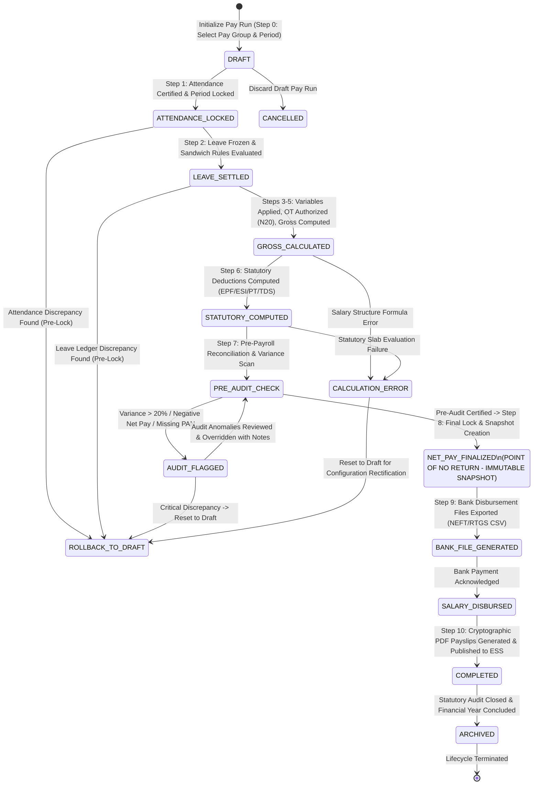
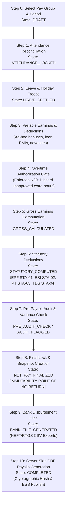
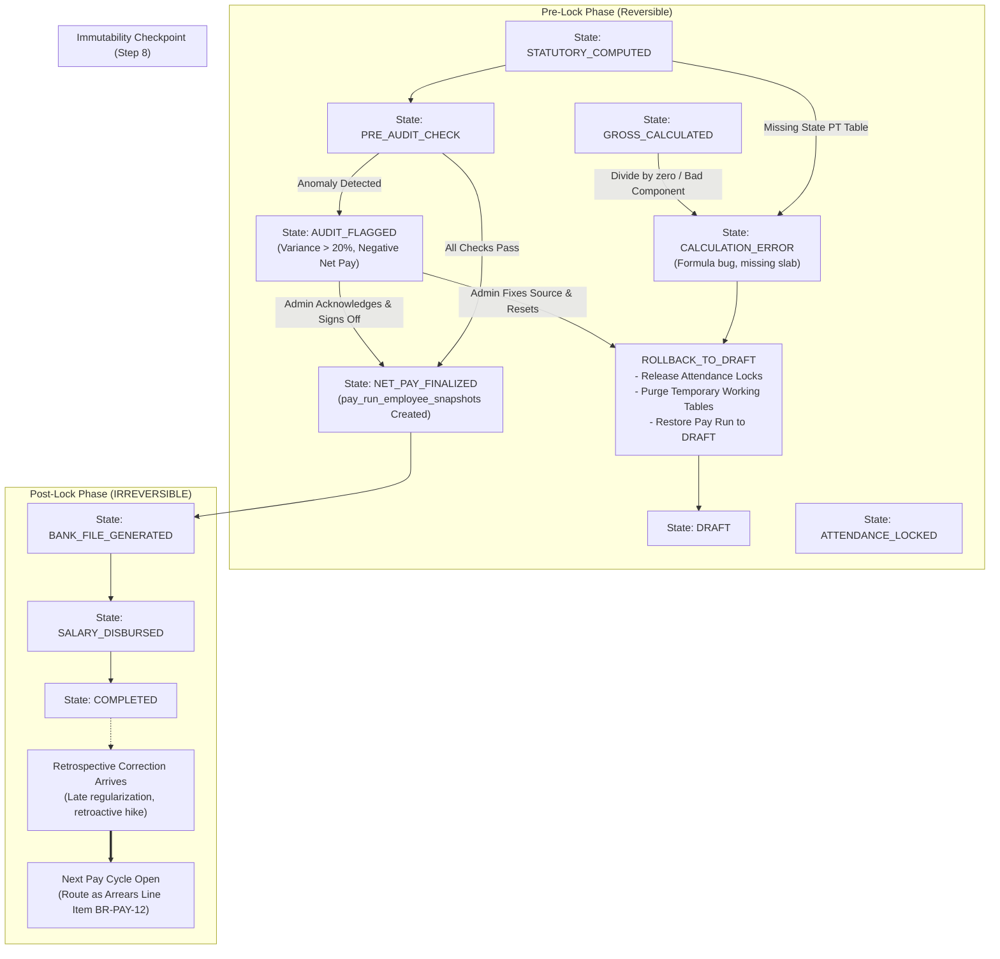
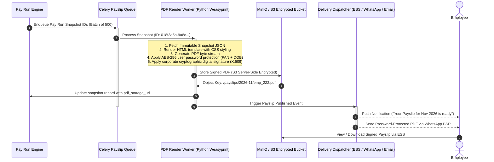

# APMS Pay Run Execution State Machine

> **Status:** Authoritative | **Last Updated:** 2026-11-16 | **Source:** Extracted from APMS documentation (`payroll/SPEC.md` §3, `BUSINESS_RULES.md` §6, `ADR-07`, `ADR-09`, `BR-PAY-12`)

---

## 1. Executive Overview & Core Architectural Invariants

The APMS Payroll & Statutory Engine (`M7`) executes compensation calculations, Indian statutory deductions (EPF, ESI, PT, TDS), banking disbursement files, and cryptographic PDF payslip generation through a deterministic, auditable finite-state machine.

### Non-Negotiable Invariants
1. **Attendance Decoupled from Payroll (`ADR-07`)**: Attendance ledgers are strictly read-only inputs to payroll. The pay run engine never mutates raw biometric punches or daily attendance records.
2. **Point of No Return (Immutability Checkpoint)**: Upon passing Step 8 Pre-Payroll Audit and entering `NET_PAY_FINALIZED`, the pay run is stamped `LOCKED`. The system generates immutable records in `pay_run_employee_snapshots`. Rollbacks to draft or in-place recalculations are strictly prohibited past this checkpoint (`BR-PAY-12`).
3. **Strict Next-Cycle Arrears Routing (`BR-PAY-12`)**: Any retrospective salary revisions, late attendance regularizations, or backdated leave adjustments for locked pay runs **never alter historical records**. Instead, the engine automatically calculates differential amounts and enqueues them as an **Arrears Adjustment in the next open pay cycle**.
4. **Parameterized Statutory Tables (`ADR-25`)**: Statutory contribution limits (EPF ₹15,000 ceiling, ESI ₹21,000 wage ceiling, state-specific PT slabs) are versioned in database tables, never hardcoded. Every pay run snapshot links to the exact statutory table versions active during calculation.

---

## 2. Complete Pay Run Lifecycle State Machine

The following state machine details every state, error branch, rollback path, and the terminal archival state of a monthly pay run.



---

## 3. Mapping the 10-Step Guided Pay Run Wizard

The pay run operates as a sequence of deterministic wizard steps. Each step transitions the pay run record (`pay_runs.status`) and enforces prerequisite validations before advancing:



### Detailed Step Specifications

| Wizard Step | Resulting State | Business Rules & Actions | Rollback / Error Handling |
| :--- | :--- | :--- | :--- |
| **Step 0: Initialization** | `DRAFT` | Initializes run for target `pay_group_id` and calendar period $[D_{start}, D_{end}]$ (`N18`). Gathers active employees in the pay group. | Can be `CANCELLED` at any time without side-effects. |
| **Step 1: Attendance Reconciliation** | `ATTENDANCE_LOCKED` | Scans for unresolved lone punches (`Q4`), missing days, or pending regularizations. Prompts HR for final resolution. Once resolved, stamps period attendance records as `LOCKED`. | Can rollback to `DRAFT` if attendance issues require re-syncing biometric devices. |
| **Step 2: Leave & Holiday Freeze** | `LEAVE_SETTLED` | Freezes double-entry leave ledgers. Executes the **Sandwich Rule Engine (`BR-LVE-02`)**: converts intervening weekly offs/holidays into leave/LOP if bounded by unapproved absences. Calculates net LOP days. | Can rollback to `DRAFT`. |
| **Step 3: Variable Earnings & Deductions** | Internal to Step 5 | Ingests ad-hoc bonuses, incentives, commissions, loan repayments, and salary advances. | Validates non-negative amounts; flags unmapped employee IDs. |
| **Step 4: Overtime Authorization** | Internal to Step 5 | Pulls only manager-approved overtime hours (`BR-OTC-01` / `N20`). Strictly excludes unapproved extra hours (`UNAUTHORIZED_EXTRA_TIME`). | Extra hours without supervisor signature are automatically dropped. |
| **Step 5: Gross Earnings Computation** | `GROSS_CALCULATED` | Evaluates employee salary structure components. Applies pro-rata formulas for mid-month joiners/leavers and deducts Loss of Pay (LOP) days (`BR-PAY-01`). | If formula fails or basic wage is negative $\rightarrow$ `CALCULATION_ERROR`. |
| **Step 6: Statutory Deductions** | `STATUTORY_COMPUTED` | Computes Indian statutory deductions: **EPF** (12% capped at ₹15,000 wage ceiling with EPS split, `STA-01`), **ESI** (0.75% employee, 3.25% employer if gross $\le ₹21,000$, `STA-02`), **PT** (state slab lookup with Feb adjustment, `STA-03`), **TDS** (annual projected tax under Sec 115BAC, `STA-04`). | If statutory slab table is missing for effective date $\rightarrow$ `CALCULATION_ERROR`. |
| **Step 7: Pre-Payroll Audit & Variance** | `PRE_AUDIT_CHECK` / `AUDIT_FLAGGED` | Executes automated anomaly scan: compares each employee's net pay against previous month. Flags net pay variance $> 20\%$, negative net pay, or missing bank details. | If anomalies detected $\rightarrow$ `AUDIT_FLAGGED`. Admin must sign off with notes or execute `ROLLBACK_TO_DRAFT`. |
| **Step 8: Final Lock & Snapshot Creation** | `NET_PAY_FINALIZED` | **POINT OF NO RETURN**: Transitions pay run to immutable locked state. Serializes complete earnings/deductions breakdown into `pay_run_employee_snapshots`. Generates tamper-proof SHA-256 hash. | **NO ROLLBACK PERMITTED**. Future corrections must route as next-cycle arrears (`BR-PAY-12`). |
| **Step 9: Bank Disbursement Files** | `BANK_FILE_GENERATED` | Generates bank-specific payment instruction files (HDFC, ICICI, SBI, Axis standard CSV formats for bulk NEFT/RTGS). | If bank account details missing for active employee, file generation pauses. |
| **Step 10: Salary Disbursed & Payslip Publishing** | `SALARY_DISBURSED` $\rightarrow$ `COMPLETED` | Bank confirmation uploaded; payslips generated via server-side cryptographic PDF engine (`ADR-26`) and published to ESS portal and WhatsApp delivery queues. | Delivery failures queued for retry without affecting pay run state. |
| **Lifecycle Archival** | `ARCHIVED` | Financial year-end closed, statutory return filed (Form 24Q, ECR, Form 5). Pay run archived for long-term DPDP/statutory compliance retention. | Read-only permanent archive. |

---

## 4. Error Handling, Anomaly Auditing & Rollback Mechanics



### Pre-Lock Rollback Mechanics (`ROLLBACK_TO_DRAFT`)
When a pay run is in any state between `ATTENDANCE_LOCKED` and `PRE_AUDIT_CHECK` / `AUDIT_FLAGGED`, a Payroll Officer can invoke `POST /api/v1/payroll/runs/{id}/rollback`. The system:
1. Deletes all rows in working calculation tables (`pay_run_working_earnings`, `pay_run_working_deductions`).
2. Clears validation warning flags and audit exceptions.
3. Unlocks the attendance period (`UPDATE attendance_daily_records SET is_locked = false WHERE period_id = :period_id`).
4. Re-sets pay run state to `DRAFT`.
5. Logs a security audit event: `"Pay run rolled back to DRAFT by User [ID]. Reason: [Notes]"`.

### Pre-Payroll Audit Anomaly Rules (`AUDIT_FLAGGED`)
The audit scan evaluates the following rules before permitting transition to Step 8:
- **Net Pay Fluctuation Rule**: Flag employee if:
  $$\frac{|\text{NetPay}_{\text{Current}} - \text{NetPay}_{\text{Previous}}|}{\text{NetPay}_{\text{Previous}}} > 0.20 \quad (\pm 20\%)$$
- **Negative Net Pay Rule**: Strictly flag if $\text{GrossEarnings} - \text{TotalDeductions} < 0$.
- **Statutory Ceiling Rule**: Flag if EPF contribution exceeds 12% of ₹15,000 without `opt_higher_pf` flag set.
- **Identity Compliance Rule**: Flag active employees missing PAN or valid Bank Account number.
- **Resolution**: An admin must either resolve the root cause via `ROLLBACK_TO_DRAFT` or provide an explicit mandatory comment to override the flag.

### Post-Lock Irreversibility Rule (`BR-PAY-12`)
Once Step 8 executes:
- The rollback endpoint returns `HTTP 409 Conflict: Cannot rollback locked pay run`.
- If an employee's attendance is subsequently regularized for the locked period, the Attendance Engine updates the explanation trace but marks the payroll impact as `UNSETTLED_ARREARS`.
- During the subsequent month's Pay Run Step 3, the variable earnings engine queries:
  ```sql
  SELECT * FROM arrears_adjustments 
  WHERE tenant_id = :tenant_id 
    AND employee_id = :employee_id 
    AND is_settled = false;
  ```
  and automatically injects the calculated difference as an `Arrears Component` into the new pay run.

---

## 5. Immutable Pay Run Snapshot Schema

Upon transitioning into `NET_PAY_FINALIZED`, the engine writes immutable rows to `pay_run_employee_snapshots`:

```sql
CREATE TABLE pay_run_employee_snapshots (
    snapshot_id UUID PRIMARY KEY DEFAULT gen_random_uuid(),
    tenant_id UUID NOT NULL,
    pay_run_id UUID NOT NULL REFERENCES pay_runs(pay_run_id),
    employee_id UUID NOT NULL REFERENCES employees(employee_id),
    
    -- Employee Demographic Snapshot at time of calculation
    employee_code VARCHAR(32) NOT NULL,
    employee_name VARCHAR(128) NOT NULL,
    designation VARCHAR(64) NOT NULL,
    department VARCHAR(64) NOT NULL,
    bank_account_number_encrypted BYTEA NOT NULL, -- PII envelope encrypted
    bank_ifsc VARCHAR(16) NOT NULL,
    pan_number_encrypted BYTEA NOT NULL,          -- PII envelope encrypted
    epf_uan VARCHAR(16),
    esi_ip_number VARCHAR(16),
    
    -- Attendance Rollup Snapshot
    payable_days NUMERIC(4, 1) NOT NULL,
    lop_days NUMERIC(4, 1) NOT NULL,
    worked_days NUMERIC(4, 1) NOT NULL,
    overtime_hours NUMERIC(6, 2) NOT NULL,
    
    -- Financial Totals
    fixed_gross NUMERIC(12, 2) NOT NULL,
    earned_gross NUMERIC(12, 2) NOT NULL,
    total_statutory_deductions NUMERIC(12, 2) NOT NULL,
    total_other_deductions NUMERIC(12, 2) NOT NULL,
    net_pay NUMERIC(12, 2) NOT NULL,
    
    -- Itemized JSONB Breakdown
    earnings_breakdown JSONB NOT NULL,
    deductions_breakdown JSONB NOT NULL,
    statutory_breakdown JSONB NOT NULL,
    
    -- Cryptographic Integrity & Table Versions
    statutory_version_ids JSONB NOT NULL,
    snapshot_hash VARCHAR(64) NOT NULL, -- SHA-256
    created_at TIMESTAMPTZ NOT NULL DEFAULT NOW(),
    
    CONSTRAINT fk_snapshot_tenant FOREIGN KEY (tenant_id) REFERENCES tenants(tenant_id)
);

-- Schema-level immutability enforcement
CREATE RULE no_update_snapshots AS ON UPDATE TO pay_run_employee_snapshots DO INSTEAD NOTHING;
CREATE RULE no_delete_snapshots AS ON DELETE TO pay_run_employee_snapshots DO INSTEAD NOTHING;
```

### JSON Breakdown Example (`statutory_breakdown`)
```json
{
  "epf": {
    "pf_gross": 15000.00,
    "employee_deduction": 1800.00,
    "employer_eps": 1250.00,
    "employer_epf": 550.00,
    "edli": 75.00,
    "admin_charges": 75.00,
    "statutory_ceiling_used": 15000.00
  },
  "esi": {
    "esi_gross": 18500.00,
    "employee_deduction": 139.00,
    "employer_contribution": 601.00,
    "wage_ceiling_used": 21000.00
  },
  "professional_tax": {
    "state": "MH",
    "pt_gross": 18500.00,
    "monthly_deduction": 200.00,
    "is_february_adjustment": false
  },
  "tds": {
    "regime": "SECTION_115BAC_NEW",
    "projected_annual_gross": 650000.00,
    "rebate_87a_eligible": true,
    "monthly_tds_deduction": 0.00
  }
}
```

---

## 6. Server-Side Cryptographic PDF Payslip Generation (`ADR-26`)

Once the pay run enters `SALARY_DISBURSED`, Step 10 initiates asynchronous background worker tasks to generate certified PDF payslips:



### Security & Integrity Highlights
1. **Password Encryption**: PDFs are protected with standard user password encryption combining uppercase PAN and Birth Year (`AAAAA9999A1992`).
2. **Server-Side Digital Signature**: Each document is cryptographically signed using an organization X.509 corporate certificate, guaranteeing that any post-generation tampering renders the PDF invalid.
3. **Audit Reproducibility**: Because the PDF is rendered strictly from `pay_run_employee_snapshots`, requesting a payslip 5 years later produces an identical artifact down to the exact paisa (±₹0.00), regardless of subsequent salary hikes or system configuration changes.
