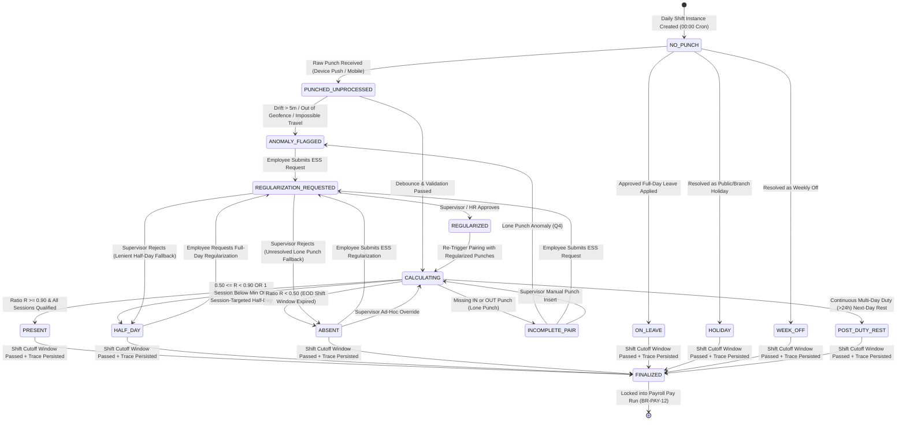
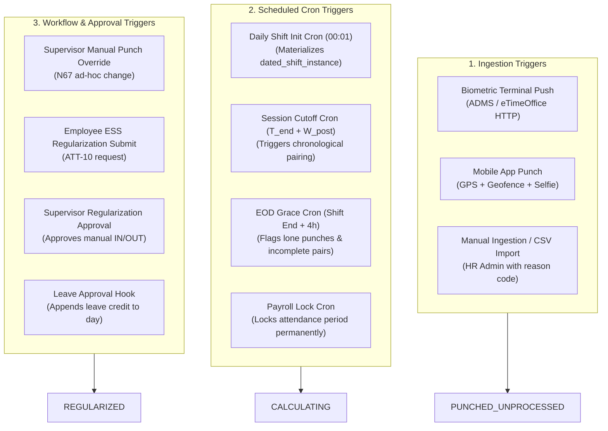
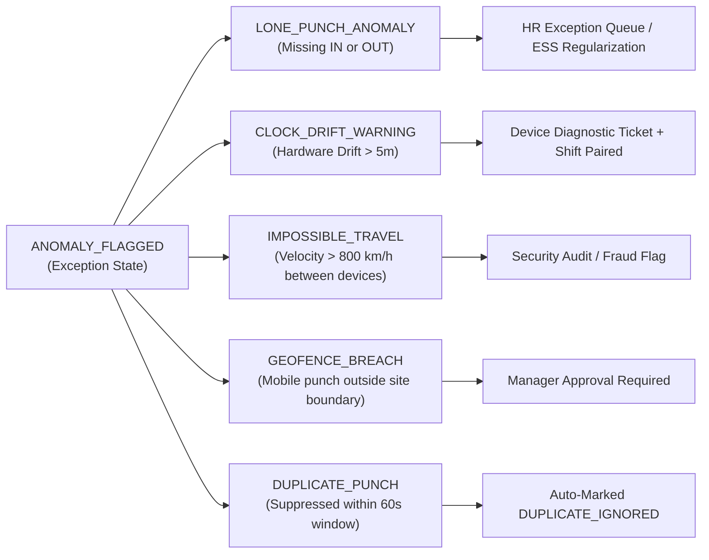

# APMS Attendance Punch-to-Status Lifecycle State Machine

> **Status:** Authoritative | **Last Updated:** 2026-11-16 | **Source:** Extracted from APMS documentation (`attendance/SPEC.md` §3, `BUSINESS_RULES.md` §2–§3)

---

## 1. Executive Overview & Core Invariants

The APMS Attendance Engine governs the deterministic lifecycle of daily employee attendance records—transforming asynchronous raw biometric device signals, mobile geofenced check-ins, and manual regularization actions into certified, immutable inputs for statutory payroll processing.

### Non-Negotiable Invariants
1. **Raw Ingestion Immutability (`BR-ING-01`)**: All incoming biometric terminal payloads, mobile punch signals, and CSV imports are persisted append-only in `raw_envelope`. They are never updated or deleted.
2. **Read-vs-Write Decoupling (`BR-ATT-18`)**: Queries for roster views, attendance grids, and payroll previews operate strictly in read-only (`SELECT`) mode without triggering side-effect mutations.
3. **Mid-Shift Gap Exclusion (`BR-ATT-02` / `N65`)**: Intervals between explicitly scheduled sessions (e.g., 12:00 to 16:00 in split shifts) are strictly non-working time, excluded from worked hours, late marks, and overtime denominators.
4. **Deterministic Explanation Trace (`SPEC §7`)**: When an attendance record reaches an evaluated or finalized status, an immutable JSON explanation trace is generated and stored in `attendance_explanation_traces`, recording exact policy bands, punch pairs, gap exclusions, and intermediate formulas.
5. **Period Lock & Next-Cycle Arrears Routing (`BR-PAY-12`)**: Once a pay period is marked `LOCKED`, its attendance records become permanently immutable. Retrospective regularizations or adjustments route automatically as an arrears adjustment into the next open pay cycle.

---

## 2. Complete Punch-to-Status State Machine

The following state machine details every state and transition an employee's daily attendance record traverses—from pre-shift schedule initialization to post-payroll lock.



---

## 3. State Definitions & Schema Attributes

| State | Classification | Description | Allowed Next States | Database Persistence |
| :--- | :--- | :--- | :--- | :--- |
| `NO_PUNCH` | Initial | Schedule instance initialized for calendar day; no physical or digital punch signals detected. | `WEEK_OFF`, `HOLIDAY`, `ON_LEAVE`, `PUNCHED_UNPROCESSED`, `ABSENT` | `attendance_daily_records.status = 'NO_PUNCH'` |
| `WEEK_OFF` | Static Non-Working | Calendar date matches employee's weekly-off pattern. Subject to Sandwich Rule audit during pay run. | `FINALIZED`, `ON_LEAVE`, `PUNCHED_UNPROCESSED` (ad-hoc work) | `status = 'WEEK_OFF'` |
| `HOLIDAY` | Static Non-Working | Calendar date matches tenant branch holiday calendar. | `FINALIZED`, `ON_LEAVE`, `PUNCHED_UNPROCESSED` (holiday duty) | `status = 'HOLIDAY'` |
| `ON_LEAVE` | Approved Leave | Employee has an approved leave request in `leave_transactions` covering full day or targeted half-day. | `FINALIZED`, `CALCULATING` (if leave cancelled) | `status = 'ON_LEAVE'` |
| `PUNCHED_UNPROCESSED` | Transient Ingestion | One or more punches ingested into `raw_envelope` and normalized into `punch_event`; awaiting debounce & pairing. | `CALCULATING`, `ANOMALY_FLAGGED` | Stored in `punch_event` with `pairing_status = 'PENDING'` |
| `ANOMALY_FLAGGED` | Exception Queue | Punch exhibits spatial, temporal, or biometric fraud indicators (clock drift > 5m, impossible travel, geofence mismatch, duplicate). | `REGULARIZATION_REQUESTED`, `CALCULATING` (if dismissed) | `anomalies[]` populated in daily record & trace |
| `CALCULATING` | Engine Pipeline | Asynchronous processing job actively executing session window pairing, gap exclusion (N65), and coverage ratio (N66a). | `PRESENT`, `HALF_DAY`, `ABSENT`, `INCOMPLETE_PAIR`, `POST_DUTY_REST` | Internal Celery/ARQ job execution state |
| `INCOMPLETE_PAIR` | Exception Queue | Shift window concluded with an odd or unpaired punch count (e.g. IN without OUT, or OUT without IN). Single-punch anomaly (Q4). | `ANOMALY_FLAGGED`, `REGULARIZATION_REQUESTED`, `ABSENT`, `HALF_DAY` | `status = 'INCOMPLETE_PAIR'` |
| `PRESENT` | Daily Rollup | Daily worked ratio $R \ge 0.90$ and all mandatory session minimum-presence requirements met (`BR-ROL-02`). Attendance credit = 1.0. | `FINALIZED`, `REGULARIZATION_REQUESTED` (disputed hours) | `status = 'PRESENT'`, credit = 1.00 |
| `HALF_DAY` | Daily Rollup | Daily worked ratio $0.50 \le R < 0.90$, or 1 session `BELOW_MIN` in a split shift, or approved half-day leave (`BR-ROL-04`). Credit = 0.5. | `FINALIZED`, `REGULARIZATION_REQUESTED` | `status = 'HALF_DAY'`, credit = 0.50 |
| `ABSENT` | Daily Rollup | Daily worked ratio $R < 0.50$, zero punches without leave on a working day, or unregularized lone punch under strict policy. Credit = 0.0. | `FINALIZED`, `REGULARIZATION_REQUESTED`, `CALCULATING` | `status = 'ABSENT'`, credit = 0.00 |
| `POST_DUTY_REST` | Statutory Rest | Assigned to the post-duty recovery calendar date following continuous duty $>24\text{h}$ / $36\text{h}$ / $48\text{h}$ (`BR-ATT-15`). Credit = 1.0. | `FINALIZED` | `status = 'POST_DUTY_REST'`, credit = 1.00 |
| `REGULARIZATION_REQUESTED` | Workflow Suspended | Employee submitted ESS regularization request with justification; pending manager approval (`ATT-10`). | `REGULARIZED`, `ABSENT`, `HALF_DAY` | `regularization_status = 'PENDING'` |
| `REGULARIZED` | Workflow Resolved | Manager/HR approved the regularization request; manual punch recorded with audit trail. | `CALCULATING` | `regularization_status = 'APPROVED'` |
| `FINALIZED` | Certified Input | Cutoff window expired, calculation certified, Explanation Trace persisted. Locked for pay run ingestion. | None (Immutable) | `is_finalized = true`, locked against direct edits |

---

## 4. State Transitions & Trigger Matrix



### Transition Detail

1. **`NO_PUNCH` $\longrightarrow$ `PUNCHED_UNPROCESSED`**
   - **Trigger**: Biometric push payload received at `/api/v1/hardware/punch` or mobile punch at `/api/v1/attendance/punch`.
   - **Actions**: Writes to `raw_envelope`, computes SHA-256 hash, parses UTC/local timestamps, creates pending `punch_event`.

2. **`PUNCHED_UNPROCESSED` $\longrightarrow$ `CALCULATING`**
   - **Trigger**: Ingestion debounce check evaluates clean (no duplicate punch within 60s, device clock drift $\le \pm 5\text{m}$, geofence verified).
   - **Actions**: Matches punches to `dated_shift_instance` session windows $[T_{start, j} - W_{pre}, T_{end, j} + W_{post}]$.

3. **`PUNCHED_UNPROCESSED` $\longrightarrow$ `ANOMALY_FLAGGED`**
   - **Trigger**: Validation detects an anomaly:
     - **Clock Drift**: Device local clock deviates by $> 5\text{ minutes}$ from NTP server (`BR-DEV-01`).
     - **Impossible Travel**: Velocity between consecutive punches across different physical biometric terminals exceeds $800\text{ km/h}$.
     - **Out-of-Geofence**: Mobile punch coordinates fall outside configured site polygon radius.
     - **Duplicate Punch**: Second punch within 60-second debounce window (`BR-PCH-01`).

4. **`CALCULATING` $\longrightarrow$ `INCOMPLETE_PAIR` (Single-Punch Anomaly `Q4`)**
   - **Trigger**: Session cutoff window passes ($T_{end} + W_{post}$) and only an IN punch or only an OUT punch exists.
   - **Actions**: Daily record tagged with `LONE_PUNCH_ANOMALY`. System enqueues exception into HR Exception Queue (`BR-ATT-04`).

5. **`INCOMPLETE_PAIR` $\longrightarrow$ `ABSENT` / `HALF_DAY` (Cutoff Fallback)**
   - **Trigger**: Monthly payroll cutoff cron executes while a lone punch remains unregularized.
   - **Actions**: Tenant policy fallback applied:
     - *Strict Policy (Default)*: Transitions to `ABSENT` (0 worked credit, LOP).
     - *Lenient Policy*: Transitions to `HALF_DAY` (0.5 credit) with penalty mark.
     - Invariant: A lone punch **never** generates overtime or full-day credit (`BR-ATT-16`).

6. **`INCOMPLETE_PAIR` / `ABSENT` $\longrightarrow$ `REGULARIZATION_REQUESTED`**
   - **Trigger**: Employee submits Attendance Regularization via ESS (`ATT-10`) supplying missing timestamp, reason category (`On Duty`, `Biometric Miss`, `Power Failure`), and optional proof attachment.
   - **Actions**: Generates approval workflow instance (`WFL-01`).

7. **`REGULARIZATION_REQUESTED` $\longrightarrow$ `REGULARIZED`**
   - **Trigger**: Reporting manager approves regularization request before payroll cutoff.
   - **Actions**: Creates certified synthetic punch with `punch_type = 'REGULARIZED'`, stores supervisor ID in audit trail.

8. **`REGULARIZED` $\longrightarrow$ `CALCULATING`**
   - **Trigger**: Approval event automatically invalidates cached pairing and schedules re-computation.
   - **Actions**: Attendance Engine re-runs the 7-step pipeline incorporating the regularized punch.

9. **`CALCULATING` $\longrightarrow$ `PRESENT` / `HALF_DAY` / `ABSENT`**
   - **Trigger**: 7-Step pipeline completes evaluation of session pairs, gap exclusion (N65), and daily rollup formula ($R$).
   - **Actions**: Persists daily rollup totals and links calculated record to explanation trace ID.

10. **`PRESENT` / `HALF_DAY` / `ABSENT` $\longrightarrow$ `FINALIZED`**
    - **Trigger**: Shift cutoff grace period expires (e.g. End of Day + 24h) or Pay Run Step 1 executes Attendance Lock.
    - **Actions**: Explanation trace locked; record marked read-only; hash generated for tamper detection.

---

## 5. Anomaly Handling & Error State Sub-Types



### Anomaly Descriptions & Resolution Rules

1. **`LONE_PUNCH_ANOMALY` (`BR-ATT-04`, `Q4`)**:
   - Occurs when an employee clocks IN but forgets to clock OUT, or vice-versa.
   - System sets `attendance_daily_records.status = 'INCOMPLETE_PAIR'`.
   - Resolution: Must be regularized by employee or overridden by supervisor. If unresolved at payroll close, falls back to configured tenant policy (`ABSENT` or `HALF_DAY`). Overtime is strictly blocked.

2. **`CLOCK_DRIFT_WARNING` (`BR-DEV-01`)**:
   - Occurs when device local time differs from server NTP time by $> 5\text{ minutes}$.
   - System normalizes timestamp using server `received_at` minus measured latency offset, flags `CLOCK_DRIFT_WARNING`, and notifies Device Administrator.

3. **`IMPOSSIBLE_TRAVEL_ANOMALY`**:
   - Occurs when consecutive punches for the same employee at different physical terminals imply superhuman velocity ($> 800\text{ km/h}$).
   - System flags possible credential sharing or biometric buddy punching; locks record in `ANOMALY_FLAGGED` state until HR manual review.

4. **`GEOFENCE_BREACH` (`BR-FLD-01`)**:
   - Mobile punch coordinates fall beyond the authorized client site / branch radius (e.g., $> 100\text{ meters}$).
   - The punch is recorded in `raw_envelope` (preserving evidence) but tagged `GEOFENCE_BREACH` and routed to supervisor for explicit approval.

---

## 6. Daily Rollup Mathematical Qualification

The transition from `CALCULATING` to evaluated daily status (`PRESENT`, `HALF_DAY`, `ABSENT`) is governed by the following mathematical criteria:

### 6.1 Multi-Session Gap Exclusion (`BR-ATT-02` / `N65`)
In a multi-session shift (e.g. Session 1: 08:00–12:00, Session 2: 16:00–20:00), the gap interval $[12:00, 16:00]$ is strictly excluded from worked hours:
$$\text{WorkedMinutes}_{\text{Daily}} = \sum_{j=1}^k \text{WorkedDuration}_j$$
$$\text{TotalWorkedHours} = \frac{\text{WorkedMinutes}_{\text{Daily}}}{60}$$
No presence or exit during the mid-shift gap is penalized or credited.

### 6.2 Worked Ratio ($R$) & Status Bands (`BR-ROL-01`, `BR-ROL-02` / `N66a`)
$$R = \frac{\sum_{j=1}^k \text{WorkedDuration}_j}{\sum_{j=1}^k \text{ScheduledDuration}_j}$$

$$\text{Status} = \begin{cases} 
\text{PRESENT} & \text{if } R \ge 0.90 \text{ AND } \forall j: \text{SessionEligibility}_j = \text{COMPLETED} \\
\text{HALF\_DAY} & \text{if } 0.50 \le R < 0.90 \text{ OR } (\exists! j: \text{SessionEligibility}_j = \text{BELOW\_MIN} \text{ in 2-session shift}) \\
\text{ABSENT} & \text{if } R < 0.50 
\end{cases}$$

### 6.3 Session Minimum Presence (`BR-ROL-03` / `N66b`)
Each session $j$ requires:
$$\text{MinPresence}_j = 0.50 \times \text{ScheduledDuration}_j$$
If an employee works 6 hours in Session 1 and 0 hours in Session 2 of a 2-session shift (total 8h scheduled), despite $R = \frac{6}{8} = 0.75$, the daily status is **strictly capped at `HALF_DAY`** because Session 2 was `BELOW_MIN`.

### 6.4 Continuous Multi-Day Duty Attribution (`BR-ATT-15` / `Q5`)
For continuous shifts spanning $>24\text{h}$, $36\text{h}$, or $48\text{h}$ (e.g. hospital resident on 36-hour duty from Nov 13, 08:00 to Nov 14, 20:00):
- The entire worked duration (36 hours) is attributed to the **shift start calendar date** (Nov 13), yielding `PRESENT` with qualifying Long-Duty Allowance.
- The subsequent recovery calendar date (Nov 14) automatically transitions to **`POST_DUTY_REST`** with full attendance credit (1.0) and zero penalty.

---

## 7. Explanation Trace Persistence Trigger

Whenever a daily record transitions into an evaluated or final status (`PRESENT`, `HALF_DAY`, `ABSENT`, `POST_DUTY_REST`, `FINALIZED`), the engine triggers an asynchronous task to persist the immutable explanation trace.

### Explanation Trace JSON Payload

```json
{
  "version": "2.0",
  "trace_id": "018f3a5b-9a8c-7000-8b01-234567890abc",
  "tenant_id": "018f3a5b-9a8c-7000-8b01-111111111111",
  "employee_id": "018f3a5b-9a8c-7000-8b01-222222222222",
  "attendance_date": "2026-11-16",
  "shift_instance_id": "018f3a5b-9a8c-7000-8b01-333333333333",
  "shift_code": "SPLIT-MORN-EVE",
  "shift_type": "MULTI_SESSION",
  "is_multi_day": false,
  "sessions": [
    {
      "session_index": 1,
      "scheduled_in": "08:00:00",
      "scheduled_out": "12:00:00",
      "paired_in": "08:03:15",
      "paired_out": "12:01:10",
      "worked_minutes": 238,
      "scheduled_minutes": 240,
      "min_presence_required_minutes": 120,
      "eligibility": "COMPLETED",
      "late_minutes": 0,
      "early_exit_minutes": 0
    },
    {
      "session_index": 2,
      "scheduled_in": "16:00:00",
      "scheduled_out": "20:00:00",
      "paired_in": "15:58:40",
      "paired_out": "20:02:15",
      "worked_minutes": 240,
      "scheduled_minutes": 240,
      "min_presence_required_minutes": 120,
      "eligibility": "COMPLETED",
      "late_minutes": 0,
      "early_exit_minutes": 0
    }
  ],
  "gap_intervals": [
    {
      "start": "12:01:10",
      "end": "15:58:40",
      "duration_minutes": 237,
      "classification": "UNTRACKED_MID_SHIFT_GAP",
      "excluded_from_worked_duration": true
    }
  ],
  "anomalies": [],
  "rollup": {
    "mode": "DURATION_RATIO",
    "total_worked_minutes": 478,
    "total_scheduled_minutes": 480,
    "coverage_ratio": 0.9958,
    "assigned_status": "PRESENT",
    "credit": 1.00,
    "overtime_minutes": 0,
    "overtime_status": "NONE"
  },
  "period_lock_status": "OPEN",
  "created_at": "2026-11-16T20:15:00.123456Z"
}
```

### Trace Immutability Guarantee
1. **Primary Key**: `trace_id` (UUIDv7).
2. **Hash Authentication**: `sha256(tenant_id || employee_id || attendance_date || trace_payload)`.
3. **Storage**: Written to `attendance_explanation_traces`. Table has PostgreSQL RLS enabled and does not permit `UPDATE` or `DELETE` grants to normal service roles.
4. **Audit Utility**: If an employee or payroll manager questions an attendance status or LOP deduction, the system reads directly from the immutable trace—reproducing the exact calculation inputs without re-executing business logic.
